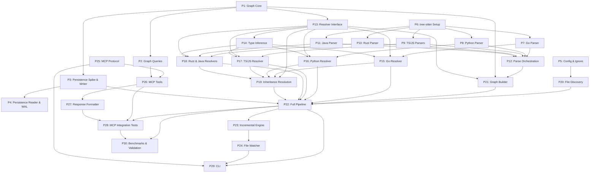

# GoGraphCtx — Project Context & Architecture Blueprint

**Project:** GoGraphCtx (Go Graph Context)
**Language:** Go
**Purpose:** A blazing-fast, accurate code-graph indexer and MCP server that LLMs can trust completely.
**Remodeled from:** CodeGraphContext (CGC) v0.6.13 — a Python-based code-graph tool with significant architectural limitations.
**License:** TBD (clean-room design; no CGC code copied)

---

## Table of Contents

1. [Mission & Goals](#1-mission--goals)
2. [Why Not CGC? — Problems We Solve](#2-why-not-cgc--problems-we-solve)
3. [Core Design Principles](#3-core-design-principles)
4. [High-Level Architecture](#4-high-level-architecture)
5. [Module Breakdown](#5-module-breakdown)
6. [Indexing Pipeline](#6-indexing-pipeline)
7. [Storage Engine](#7-storage-engine)
8. [Parsing Layer](#8-parsing-layer)
9. [Symbol Resolution & Call Graph](#9-symbol-resolution--call-graph)
10. [Incremental Updates (File Watcher)](#10-incremental-updates-file-watcher)
11. [MCP Server & Tool Surface](#11-mcp-server--tool-surface)
12. [Output Format & LLM Trust](#12-output-format--llm-trust)
13. [Accuracy & Verification Strategy](#13-accuracy--verification-strategy)
14. [Performance Targets](#14-performance-targets)
15. [What We Keep from CGC](#15-what-we-keep-from-cgc)
16. [Technology Choices](#16-technology-choices)
17. [Project Structure](#17-project-structure)
18. [30-Phase Core Backend Development Plan](#18-30-phase-core-backend-development-plan)
19. [Risk Register](#19-risk-register)
20. [Glossary](#20-glossary)

---

## 1. Mission & Goals

### Mission Statement

Build a **single-binary, zero-dependency code-graph indexer** that produces output so accurate, well-structured, and precisely scoped that **LLMs treat it as ground truth** — not suggestions to verify.

### Primary Goals

| # | Goal | Measure of Success |
|---|------|-------------------|
| G1 | **Blazing speed** | Index a medium repo (10k files) in <5s; Flask (83 .py files) in <1s |
| G2 | **Trusted by LLMs** | Claude/GPT use our MCP output directly without hedging ("based on the tool output" not "if the tool output is accurate") |
| G3 | **Architecture superiority** | Single storage engine, no shims, no dialect translation, clean module boundaries |
| G4 | **Resolution accuracy** | ≥90% of call edges from strong tiers (vs CGC's 39%); zero "alphabetical-first" guesses emitted as facts |
| G5 | **Reliability** | Crash-safe indexing (transactions), resumable jobs, deterministic output |
| G6 | **Minimal footprint** | Single static binary <30MB; peak RSS <200MB for 10k-file repos |
| G7 | **Instant incremental updates** | <100ms per file change, cost proportional to change size not repo size |
| G8 | **LLM-optimized MCP** | 5–8 focused tools (not 29); structured responses with confidence metadata |

### Non-Goals for v1

- Web visualizer, React UI, or website
- ORM/Spring/Gradle/Maven/MyBatis framework linkers
- Bundle registry / Hugging Face integration
- Database ingestion (MySQL, Cassandra, Redis metadata)
- Embedding vectors on nodes
- More than 6 initial languages

---

## 2. Why Not CGC? — Problems We Solve

### 2.1 Speed — DB Writes Are the Bottleneck

**CGC Problem:** On Flask (83 Python files, ~18k lines), indexing took 7–61 seconds depending on backend. Database writes consumed 85–95% of runtime on embedded backends. Pure compute (parse + resolve) was only ~3 seconds.

**Root cause:** CGC writes through Cypher `MERGE` statements to a general-purpose graph database. The embedded Kùzu/LadybugDB backends degrade to one query per row due to compatibility issues. Even FalkorDB spends most time serializing graph operations.

**Our fix:** No external graph database. Build the graph in memory during indexing, then bulk-serialize to a custom compact format. The graph IS our data structure, not a database we talk to through a query language.

### 2.2 Architecture — Six Backends, One Shim

**CGC Problem:** Six database backends (FalkorDB Lite, FalkorDB remote, KùzuDB, LadybugDB, Neo4j, Nornic) share one Cypher write path through a 1,650-line regex-based query translation shim and a 2,714-line writer with backend-specific branches. KùzuDB was archived upstream. FalkorDB Lite doesn't work on Windows.

**Our fix:** One storage engine. One format. Zero translation layers. Cross-platform by default (Go compiles everywhere).

### 2.3 Accuracy — 61% of Call Edges Are Guesses

**CGC Problem:** On Flask, only 39% of call edges came from strong resolution tiers. 47% came from tier 7 (path-substring matching — `_t` matches `account_tax/…`) and 13% from tier 8 (alphabetical-first among candidates). The resolver is a single 1,550-line function mixing all languages.

**Our fix:**
- **Real module resolution** per language (Go module paths, Python package resolution, TS path aliases) instead of path-substring matching
- **Receiver-type inference** from assignments, constructors, annotations, and parameter types
- **Never emit guesses as facts** — uncertain edges are explicitly marked with candidate sets
- **Per-language resolution modules** behind a common interface

### 2.4 Incremental Updates — O(repo) Per Save

**CGC Problem:** Every file save triggers: stat every file in the repo, deep-copy the entire parsed-facts cache, potentially invalidate all source files, and re-resolve under a global lock. Cost grows with repo size regardless of change size.

**Our fix:** Maintain a reverse dependency index (symbol → dependent files). On change, re-parse only the changed file, re-resolve only affected edges. No deep copies. Cost proportional to the change's blast radius.

### 2.5 LLM Trust — Why Claude Doesn't Trust CGC Output

**CGC Problem:** CGC's MCP responses include edges that are essentially guesses (tier 7/8), but presents them alongside confident results without clear differentiation. It has 29 tools flooding the agent's context. Response sizes can be unpredictable. Path-substring matches produce phantom relationships.

**Our fix:**
- **Structured confidence** in every response: "3 certain callers, 2 likely, 1 uncertain (candidates: A, B, C)"
- **Minimal tool surface** — 5–8 tools, each doing one thing well
- **Deterministic, reproducible output** — same input always produces same output
- **Precise scoping** — responses are compact, relevant, and never include phantom relationships
- **Source provenance** on every fact — file, line, resolution method

### 2.6 Operational Pain

**CGC Problem:** ~90 pip dependencies, 1-second CLI startup, PATH-fix scripts, platform-specific package exclusions, transitive version conflicts requiring manual pins, 1.4GB peak RSS for small repos on some backends.

**Our fix:** `go install` or download a single binary. Zero runtime dependencies. <50ms startup. <200MB RSS.

---

## 3. Core Design Principles

### P1: Compute, Don't Query
Build the graph in memory. Don't serialize to a database just to query it back. The graph is a data structure, not a service.

### P2: Honest Over Complete
Never present a guess as a fact. It's better to say "unresolved, 3 candidates" than to pick one and be wrong. LLMs trust tools that admit uncertainty more than tools that confidently lie.

### P3: Change-Proportional Work
Every operation should cost proportional to the size of the change, not the size of the repository. No global scans, no deep copies, no full re-resolution on a single file edit.

### P4: One Way to Do Each Thing
One storage format. One resolution pipeline per language. One MCP transport. Configuration is for tuning, not for switching architectures.

### P5: Parse Once, Resolve Once, Write Once
No double parsing. No redundant passes. Data flows through the pipeline exactly once in the happy path.

### P6: Static Binary, Zero Dependencies
Ship as a single binary that works on Linux, macOS, and Windows. No Docker required. No runtime installations. `curl | tar` and you're running.

### P7: Precision-Layered Resolution
Start with what we can determine from syntax (fast, always available). Layer on type inference (medium cost, high value). Optionally layer on LSP/SCIP data (high cost, compiler-accurate). Each layer upgrades edges in place.

---

## 4. High-Level Architecture

```
                    ┌─────────────────────────────────────────────────┐
  AI IDEs ──stdio──►│  MCP Server (5-8 focused tools)                │
  (Cursor, Claude,  │    find_symbol | callers | callees | impact    │
   Windsurf, etc.)  │    file_outline | search | repo_stats          │
                    └───────────┬─────────────────────────────────────┘
                                │ queries in-memory graph
                                │
         ┌──────────────────────▼──────────────────────────┐
         │                 Graph Engine                     │
         │  In-memory graph: nodes + edges + indexes        │
         │  Bulk load from / serialize to compact format    │
         │  Reverse index: symbol → dependents              │
         │  Confidence-annotated edges                      │
         └──────┬───────────────┬───────────────┬──────────┘
                │               │               │
       ┌────────▼─────┐  ┌─────▼──────┐  ┌─────▼──────────┐
       │  Parser       │  │  Resolver  │  │  Watcher       │
       │  (per-lang)   │  │  (per-lang)│  │  (fsnotify)    │
       │               │  │            │  │  change-prop.  │
       │  tree-sitter   │  │  module    │  │  incremental   │
       │  → Go walker   │  │  resolution│  │  re-resolution │
       │               │  │  + type    │  │                │
       │  One pass:    │  │  inference │  │                │
       │  names+facts  │  │            │  │                │
       └──────────────┘  └────────────┘  └────────────────┘
                │               │
       ┌────────▼───────────────▼──────┐
       │       Serializer              │
       │  Graph ↔ compact binary file  │
       │  (.ggctx format)              │
       │  Atomic writes, checksummed   │
       └───────────────────────────────┘
```

### Data Flow (Index)

```
Files on disk
  │
  ▼
Discover (walk tree, apply .ggctxignore)
  │
  ▼
Parse (tree-sitter + Go walker, one pass per file, fully parallel)
  │  Produces: ParsedFile { functions, classes, imports, calls, variables }
  ▼
Build Graph (in-memory: add nodes, CONTAINS edges, IMPORTS edges)
  │
  ▼
Resolve (per-language module resolution + type inference → CALLS edges with confidence)
  │
  ▼
Link (inheritance, implements, decorators)
  │
  ▼
Serialize (atomic write to .ggctx file)
```

### Data Flow (Query via MCP)

```
LLM sends tool call (e.g., find callers of function X)
  │
  ▼
MCP Handler validates + routes
  │
  ▼
Graph Engine: index lookup → traverse edges → collect results
  │
  ▼
Response Formatter: apply token budget, attach confidence, strip paths
  │
  ▼
Structured JSON response back to LLM
```

---

## 5. Module Breakdown

```
gographctx/
├── cmd/                     # CLI entry points
│   └── gographctx/          # main binary
│       └── main.go
├── internal/                # Private implementation
│   ├── graph/               # Core graph engine
│   │   ├── graph.go         # Compact Graph data structure, atomic ReplaceFile, View
│   │   ├── node.go          # Node types and 13 NodeKind definitions
│   │   ├── edge.go          # ResolutionTier-driven Edge types & CallSiteRef provenance
│   │   ├── callsite.go      # Unresolved, ambiguous & external CallSite records
│   │   ├── fragment.go      # Lock-free FileFragment & bulk MergeFragments
│   │   ├── intern.go        # String & label deduplication pools
│   │   ├── uid.go           # Stable UID (Kind, QName, Occurrence) & SigHash
│   │   ├── query.go         # Graph query operations (callers, callees, chains, etc.)
│   │   └── index.go         # Secondary indexes, adjacency queries & verification
│   ├── storage/             # Persistence (Snapshot + Append-Only WAL)
│   │   ├── format.go        # Snapshot & WAL binary format definitions
│   │   ├── writer.go        # Snapshot serialization & WAL delta append
│   │   ├── reader.go        # Snapshot + WAL replay into memory
│   │   └── spike_test.go    # Phase 3 benchmark spike: SQLite vs Snapshot+WAL
│   ├── parser/              # Parsing layer
│   │   ├── parser.go        # Common parser interface
│   │   ├── coordinator.go   # Parallel parse orchestration
│   │   ├── result.go        # ParsedFile type definitions
│   │   ├── lang/            # Per-language parsers
│   │   │   ├── golang.go
│   │   │   ├── python.go
│   │   │   ├── typescript.go
│   │   │   ├── javascript.go
│   │   │   ├── rust.go
│   │   │   └── java.go
│   │   └── treesitter/      # tree-sitter Go bindings and grammar management
│   │       └── manager.go
│   ├── resolver/            # Symbol resolution
│   │   ├── resolver.go      # Common resolver interface + confidence types
│   │   ├── types.go         # Type inference engine
│   │   ├── lang/            # Per-language resolution
│   │   │   ├── golang.go    # Go module resolution (go.mod, package paths)
│   │   │   ├── python.go    # Python import resolution (packages, relative imports)
│   │   │   ├── typescript.go # TS/JS resolution (node_modules, path aliases, tsconfig)
│   │   │   ├── rust.go      # Rust resolution (crate paths, use statements)
│   │   │   └── java.go      # Java resolution (packages, classpath)
│   │   └── tiers.go         # Resolution tier definitions and confidence scoring
│   ├── pipeline/            # Indexing pipeline orchestration
│   │   ├── pipeline.go      # Main pipeline: discover → parse → build → resolve → serialize
│   │   ├── discover.go      # File discovery with .ggctxignore
│   │   └── builder.go       # Graph construction from parsed results
│   ├── watcher/             # Incremental file watching
│   │   ├── watcher.go       # fsnotify-based watcher with debouncing
│   │   ├── incremental.go   # Change-proportional re-indexing logic
│   │   └── deptracker.go    # Reverse dependency tracking
│   ├── storage/             # Serialization
│   │   ├── format.go        # .ggctx binary format definition
│   │   ├── writer.go        # Atomic graph serialization
│   │   └── reader.go        # Graph deserialization
│   ├── mcp/                 # MCP server
│   │   ├── server.go        # MCP protocol handler (stdio JSON-RPC)
│   │   ├── tools.go         # Tool definitions (5-8 tools)
│   │   ├── handlers.go      # Tool request handlers
│   │   └── formatter.go     # Response formatting, token budgets, confidence
│   └── config/              # Configuration
│       └── config.go        # Settings, defaults, .ggctxignore parsing
├── pkg/                     # Public API (if needed for library use)
│   └── types/               # Shared type definitions
│       └── types.go
├── testdata/                # Test fixtures
│   ├── golden/              # Golden file tests (from CGC idea, extended)
│   └── repos/               # Real repo snapshots for accuracy benchmarks
├── go.mod
├── go.sum
├── Makefile
├── CONTEXT.md               # This file
└── README.md
```

### Module Responsibilities

| Module | Responsibility | Lines (est.) | Dependencies |
|--------|---------------|-------------|-------------|
| `graph` | In-memory graph data structure, indexes, query traversals | 800–1200 | None (stdlib only) |
| `parser` | Tree-sitter parsing, per-language fact extraction | 1500–2500 | tree-sitter Go bindings |
| `resolver` | Symbol resolution, type inference, confidence scoring | 1200–2000 | `graph`, `parser` |
| `pipeline` | Orchestrates discover → parse → build → resolve → serialize | 400–600 | All internal modules |
| `watcher` | fsnotify watching, incremental updates, dep tracking | 500–800 | `pipeline`, `graph` |
| `storage` | Binary serialization/deserialization of the graph | 400–600 | `graph` |
| `mcp` | MCP server, tool definitions, response formatting | 600–1000 | `graph`, `resolver` |
| `config` | Configuration loading, ignore patterns | 200–300 | None |

**Total estimated core: ~5,500–9,000 lines of Go** (vs CGC's ~59,800 lines of Python for comparable functionality).

---

## 6. Indexing Pipeline

### Pipeline Stages

```
┌─────────┐    ┌───────┐    ┌───────┐    ┌─────────┐    ┌───────────┐
│Discover │───►│ Parse │───►│ Build │───►│ Resolve │───►│ Serialize │
│         │    │       │    │       │    │         │    │           │
│ Walk FS │    │ TS +  │    │ Nodes │    │ Module  │    │ Atomic    │
│ Filter  │    │ Go    │    │ Edges │    │ resolve │    │ write to  │
│ Collect │    │ walk  │    │ Index │    │ Type    │    │ .ggctx    │
│         │    │       │    │       │    │ infer   │    │           │
│ O(files)│    │ ‖ per │    │ O(n)  │    │ O(calls)│    │ O(graph)  │
│         │    │ file  │    │       │    │         │    │           │
└─────────┘    └───────┘    └───────┘    └─────────┘    └───────────┘
```

### Stage Details

#### Stage 1: Discover
- Walk the file tree using `filepath.WalkDir` (single pass, no double-walk)
- Apply `.ggctxignore` patterns (gitignore-compatible syntax)
- Default ignores: `.git`, `node_modules`, `vendor`, `__pycache__`, `dist`, `build`, `target`, `.venv`
- Collect files grouped by language (detected by extension)
- Output: `[]FileGroup` — files organized by language

#### Stage 2: Parse (Fully Parallel)
- **One pass per file** (not two like CGC)
- Each file parsed in its own goroutine (true parallelism, no GIL)
- tree-sitter C parser called via cgo — releases Go scheduler, runs on OS thread
- Go walker traverses the syntax tree and extracts:
  - Functions (name, params, return type, decorators, docstring, complexity, start/end lines)
  - Classes/Structs/Interfaces (name, fields, methods, bases)
  - Imports (what, from where, alias)
  - Call sites (caller, callee name, receiver expression, arguments, line)
  - Variables (name, type annotation, assigned value hint)
  - Module-level code (synthetic `<module>` scope)
- **Name collection happens during the same parse** — no separate pre-scan
- Output: `[]ParsedFile` — one per source file

#### Stage 3: Build Graph
- Workers construct lock-free `FileFragment` values in parallel and merge in bulk via `MergeFragments`
- **Stable identity**: `uid = hash(kind, qualified_name, occurrence)` — line numbers and parameter types are excluded so routine edits and adding type annotations preserve symbol identity
  - `qualified_name` = `module_path::ClassName::method_name` (required for all non-File nodes; no ambiguous `File::Name` fallback)
  - `occurrence` = 0-based index among same-`(Kind, QName)` siblings (handles multiple Go `init()` functions cleanly)
  - `signature_hash` (`SigHash`) is stored separately on `Node` to detect API signature changes during incremental updates
- Add `CONTAINS` edges (`File → symbols`, `TierStructural`) and `IMPORTS` edges (`File → imported modules/symbols`)
- Build compact in-memory indexes using dense `uint32` internal IDs and string interning:
  - `byName`: symbol name → `idList`
  - `byFile`: file path → `idList`
  - `byQName`: qualified name → `idList` (`GetByQName` returns all matches; `GetUniqueByQName` enforces uniqueness)
  - `callSitesByLookup`: lookup key → unresolved/ambiguous `CallSite` indices for $O(\text{affected})$ negative-dependency resolution
- Output: populated `Graph` with nodes, multi-site provenance edges, unresolved call sites, and compact indexes

#### Stage 4: Resolve
- **Per-language module resolution** (not path-substring matching):
  - **Go**: Parse `go.mod`, resolve import paths to packages, match method calls via receiver types
  - **Python**: Resolve relative imports, `__init__.py` packages, `sys.path` semantics
  - **TypeScript/JavaScript**: `tsconfig.json` paths, `package.json` main/exports, `node_modules` resolution
  - **Rust**: Crate root, `mod` declarations, `use` paths
  - **Java**: Package declarations, classpath, import statements
- **Receiver-type inference**: For `x.method()`, determine the type of `x` from:
  - Direct assignment: `x = SomeClass()` → type is `SomeClass`
  - Parameter annotation: `def foo(x: SomeClass)` → type is `SomeClass`
  - Return type: `x = get_client()` where `get_client() -> Client` → type is `Client`
  - Constructor patterns: `x := NewClient()` → type is `Client` (Go convention)
- **Tiered confidence (`ResolutionTier` as single source of truth — numeric confidence and labels derive strictly from it):**

| Tier | Constant | Rule | Confidence | Label | Edge / Record Type |
|---:|---|---|---:|---|---|
| 0 | `TierStructural` | Syntactic structural link | 1.00 | certain | `CONTAINS` / `IMPORTS` / `INHERITS` / `IMPLEMENTS` / `DECORATED_BY` |
| 1 | `TierSelf` | Explicit self/this/super receiver | 1.00 | certain | `CALLS` |
| 2 | `TierLocal` | Local definition in same file | 0.98 | certain | `CALLS` |
| 3 | `TierQualifiedImport` | Fully-qualified import, unique match | 0.95 | certain | `CALLS` |
| 4 | `TierReceiverType` | Receiver-type inferred + method resolved | 0.90 | certain | `CALLS` |
| 5 | `TierModuleUnique` | Module resolution, unique match | 0.88 | certain | `CALLS` |
| 6 | `TierSamePackage` | Same-package, unique match | 0.85 | certain | `CALLS` |
| 7 | `TierTypeNarrowed` | Multiple candidates, type-narrowed | 0.60 | likely | `LIKELY_CALLS` (or ambiguous `CallSite`) |
| 8 | `TierUnresolved` | Unresolved / external — candidates & lookup key recorded | 0.00 | unresolved | `CallSite` (never emitted as `CALLS`) |

**Key difference from CGC**: Tiers 7+ never produce a `CALLS` edge, and `ResolutionTier` is strictly cross-checked against `EdgeKind`. Ambiguous and unresolved calls are stored as `CallSite` records with candidate UIDs and lookup keys — we never emit guesses as facts.

#### Stage 5: Persist (Snapshot + Append-Only WAL)
- Base graph snapshot written atomically (`temp → fsync → rename`) after full repository indexing, with optional zstd compression and SHA-256 verification
- Incremental edits (`ReplaceFile`) append compact `O(file)` delta records to an append-only WAL instead of rewriting the full snapshot, preserving Principle **P3 (Change-Proportional Work)**
- Periodic background compaction folds the WAL into a fresh base snapshot once WAL growth crosses a threshold

### Pipeline Characteristics

| Property | CGC | GoGraphCtx |
|----------|-----|-----------|
| Parse passes per file | 2 (pre-scan + full) | 1 |
| Parse parallelism | Thread pool, GIL-bound | Goroutines, true parallel |
| Graph construction | Via Cypher MERGE to DB | Direct in-memory insertion |
| Resolution | 1,550-line mixed function | Per-language modules, <300 lines each |
| Write | Sequential per-file Cypher | Single bulk serialize |
| Crash safety | No transactions, partial state | Atomic file swap |
| Determinism | Sort before write (fix) | Deterministic by construction |

---

## 7. Storage Engine

### Design: Memory-First Serving + Base Snapshot + Incremental WAL

CGC's biggest performance problem is writing to and querying an external/embedded graph database via Cypher. We eliminate that bottleneck completely:

- **During indexing & querying:** The graph lives in compact contiguous Go slices with `uint32` internal IDs (`<150 MB` heap for 150k nodes and 600k edges; parallel `FileFragment` build + bulk merge in `<0.5s`). Reads use `Graph.View(...)` for consistent multi-call snapshots.
- **At rest:** Persistence combines a **Base Snapshot** (`index.ggctx`) written on full index with an **Append-Only WAL** (`index.wal`) for incremental `ReplaceFile` updates. On startup, the reader streams the snapshot and replays WAL frames to reconstruct the in-memory graph rather than trying to `mmap` Go pointer/map structures directly.
- **Phase 3 Spike Rule:** Before locking in the custom Snapshot+WAL binary layout in Phase 3, benchmark **SQLite (WAL mode + startup bulk load)** vs **custom Snapshot+WAL** at the 150k-node / 600k-edge target scale so storage decisions rest on measured numbers.

### Snapshot & WAL Persistence Architecture

```
┌──────────────────────────────────────┐
│ Base Snapshot (index.ggctx)          │
│   Header (Magic, Version, SHA-256)   │
│   Interned String & Label Tables     │
│   Node Records (UID, Kind, Occ, Sig) │
│   Edge Records (Tier + Sites[])      │
│   CallSite Records (LookupKey, Cands)│
├──────────────────────────────────────┤
│ Append-Only WAL (index.wal)          │
│   CRC-framed ReplaceFile(file) ops   │
│   O(changed file) append per save    │
│   Compacted into base snapshot async │
└──────────────────────────────────────┘
```

### Why Not External Graph DBs or Monolithic File Rewrites?

| Option | Trade-off / Decision |
|--------|----------------------|
| Neo4j / FalkorDB / KùzuDB | External or slow embedded DB; write amplification caused CGC's 7–61s Flask bottleneck |
| Monolithic single `.ggctx` rewrite | Rewriting the whole snapshot on every file save violates **P3 (Change-Proportional Work)** |
| `mmap` directly over Go maps | Go maps/slices require deserialization into managed heap objects; sequential snapshot streaming + WAL replay is honest and fast |
| SQLite (WAL + startup bulk load) | **Rejected after Phase 3 Spike** (150k/600k: 18.87s write, 3.50s load, 10.6ms 1-file tx, 75.84 MB disk vs Snapshot+WAL: 0.61s raw / 0.89s zstd write, 0.44s raw / 0.50s zstd load, <0.55ms WAL append, 7.85 MB zstd / 19.56 MB raw) |
| BadgerDB / BoltDB | Key-value stores add B+tree write amplification with no benefit over Memory-First + Snapshot+WAL |

### Graph Data Structures (In-Memory)

Exported getters return safe value copies (`Node`, `Edge`, `CallSite`) so callers cannot corrupt indexes; multi-call queries use `Graph.View(func(v *ReadView))` under a single read lock.

```go
type Graph struct {
    mu   sync.RWMutex
    init bool

    // Dense contiguous storage keyed by uint32 internal IDs (with free-list reuse)
    nodes       []Node
    uidToID     map[UID]uint32
    edges       []edgeEntry          // stores PrimarySite inline + optional ExtraSites
    edgeToID    map[compactEdgeKey]uint32

    // O(1)/O(d) adjacency slices indexed by nodeID (callers/callees/contains/revDeps derived directly)
    outgoing    [][]uint32
    incoming    [][]uint32

    // Secondary node indexes (singleton-optimized idList values)
    byName      map[string]idList
    byFile      map[string]idList
    byQName     map[string]idList    // GetByQName returns []Node; GetUniqueByQName checks ambiguity

    // Unresolved, ambiguous & external calls + negative-dependency invalidation index
    callSites         []CallSite
    callSitesByCaller map[UID][]int
    callSitesByFile   map[string][]int
    callSitesByLookup map[string][]int

    strings *stringPool
    labels  *labelPool
}

type Node struct {
    UID           UID      // hash(Kind, QName, Occurrence) — stable across line & annotation edits
    Kind          NodeKind // 13 kinds: File..Decorator + External
    Name          string
    QName         string   // Required for all non-File nodes
    Occurrence    uint16   // Disambiguates same-(Kind, QName) siblings (e.g. Go init())
    SignatureHash SigHash  // Digest of param types & return type for API diffing
    File          string
    StartLine     uint32
    EndLine       uint32
    Language      string
    Type          string
    Receiver      string
    Exported      bool
    Params        []Param
    ReturnType    string
    Decorators    []string
    Docstring     string
    Complexity    uint16
    Bases         []string
}

type CallSiteRef struct {
    Line   uint32
    Column uint16
    Tier   ResolutionTier
    Label  string
}

type Edge struct {
    Source UID
    Target UID
    Kind   EdgeKind       // CALLS, LIKELY_CALLS, CONTAINS, IMPORTS, INHERITS, IMPLEMENTS, DECORATED_BY
    Tier   ResolutionTier // Single source of truth for Confidence() and ConfidenceLabel()
    Label  string
    Sites  []CallSiteRef  // Retains all call-site lines between (Source, Target, Kind)
}

type CallSite struct {
    Caller     UID
    File       string
    Line       uint32
    Column     uint16
    CalleeExpr string
    LookupKey  string         // Enables O(affected) negative-dependency resolution
    Candidates []UID
    Status     CallStatus     // unresolved | ambiguous | external
    Tier       ResolutionTier
    Reason     string
}
```

### Node Kinds (13 Core Kinds, Down from CGC's 29)

| Kind | Description |
|------|------------|
| `File` | A source file |
| `Module` | A package/module/crate |
| `Function` | A function or method |
| `Class` | A class |
| `Struct` | A struct (Go, Rust, C) |
| `Interface` | An interface or trait |
| `Enum` | An enumeration |
| `Variable` | A module-level or class-level variable/constant |
| `Parameter` | A function parameter |
| `Property` | A class/struct field or property |
| `TypeAlias` | A type alias or typedef |
| `Decorator` | A decorator or annotation |
| `External` | External/stdlib target symbol not defined inside the indexed repository |

Sentinel constants (`numNodeKinds`, `numEdgeKinds`, `numResolutionTiers`, `numCallStatuses`) and table-completeness unit tests enforce that enum tables stay synchronized as kinds are extended.

---

## 8. Parsing Layer

### Design: tree-sitter + Go Walkers

Like CGC, we use tree-sitter grammars for parsing. Unlike CGC:
- We run pure-Go tree-sitter (`gotreesitter`) with compiled-in grammars — no Python overhead and no CGo toolchain required (`CGO_ENABLED=0` compatible)
- We write Go tree-walkers instead of Python tree-walkers — true parallelism
- **We parse each file exactly once** — name collection and full extraction in a single pass
- We use tree-sitter queries (`.scm` files) where practical for declarative extraction, falling back to programmatic walking for complex patterns

### Parser Interface

```go
type LanguageParser interface {
    // Language returns the language identifier
    Language() string
    
    // Extensions returns file extensions this parser handles
    Extensions() []string
    
    // Parse extracts all facts from a single file in one pass
    Parse(path string, content []byte, tree *sitter.Tree) (*ParsedFile, error)
}
```

### Parallel Parse Orchestration

```go
func ParseAll(files []FileInfo, workers int) ([]*ParsedFile, error) {
    results := make([]*ParsedFile, len(files))
    g, ctx := errgroup.WithContext(context.Background())
    g.SetLimit(workers) // default: runtime.NumCPU()
    
    for i, f := range files {
        i, f := i, f
        g.Go(func() error {
            parser := getParser(f.Language)
            result, err := parser.Parse(f.Path, f.Content, f.Tree)
            results[i] = result
            return err
        })
    }
    return results, g.Wait()
}
```

### Single-Pass Extraction

CGC runs a "pre-scan" that parses every file to collect class/function names into an `imports_map`, then parses every file again for full extraction. We do both in one pass:

1. Parse the file with tree-sitter
2. Walk the tree, extracting all facts (functions, classes, imports, calls, variables)
3. The name-collection data (what names this file defines) is a subset of the full extraction — it comes for free

The `imports_map` equivalent is built after all files are parsed, from the extracted data, before resolution begins.

### Grammar Management

- Grammars are compiled into the binary at build time (no runtime downloads)
- Initial languages: Go, Python, TypeScript, JavaScript, Rust, Java
- Adding a language: implement `LanguageParser` interface + include grammar in build

### Why Not tree-sitter Queries (.scm) for Everything?

tree-sitter queries are great for simple extractions ("find all function definitions"). But for complex patterns (inferring receiver types, handling nested scopes, tracking variable assignments through control flow), programmatic walking is clearer and more maintainable. We use a hybrid approach:

- `.scm` queries for: function/class/import declarations, decorators, simple call sites
- Go walkers for: scope analysis, type inference hints, complex call patterns, language-specific idioms

---

## 9. Symbol Resolution & Call Graph

### Architecture: Per-Language Resolvers

```go
type LanguageResolver interface {
    // Language returns the language identifier
    Language() string
    
    // ResolveImports resolves import statements to target modules/files
    ResolveImports(file *ParsedFile, graph *Graph) []ResolvedImport
    
    // ResolveCalls resolves call sites to target symbols
    ResolveCalls(file *ParsedFile, graph *Graph, imports []ResolvedImport) []ResolvedCall
    
    // InferTypes infers types of local variables for receiver resolution
    InferTypes(file *ParsedFile, graph *Graph) map[string]TypeInfo
}
```

### Resolution Pipeline

```
For each file:
  1. Resolve imports → map of imported names to target modules/symbols
  2. Infer local variable types → map of variable names to types
  3. For each call site:
     a. Try self/this/super receiver → Tier 1
     b. Try local definition → Tier 2
     c. Try fully-qualified import match → Tier 3
     d. Try receiver type + method resolution → Tier 4
     e. Try module resolution → Tier 5
     f. Try same-package unique match → Tier 6
     g. If multiple candidates with partial type info → Tier 7 (LIKELY_CALLS)
     h. If unresolved → store as UnresolvedCall (no edge emitted)
```

### Type Inference Engine

The key accuracy improvement over CGC. For expressions like `client.get(...)`, we determine the type of `client`:

```go
type TypeInference struct {
    // Assignment tracking: x = SomeClass() → x has type SomeClass
    Assignments map[string]TypeInfo
    
    // Parameter types: def foo(x: SomeClass) → x has type SomeClass
    Parameters  map[string]TypeInfo
    
    // Return types: x = get_client() where get_client returns Client → x has type Client
    ReturnTypes map[string]TypeInfo
    
    // Constructor patterns: x := NewClient() → x has type Client (Go convention)
    Constructors map[string]TypeInfo
}
```

This is not full type inference (that's a compiler's job). It's **pragmatic type hints** covering the most common patterns that CGC misses entirely.

### Module Resolution vs Path-Substring Matching

**CGC (Tier 7):** `import_name` with dots converted to slashes is checked as a substring of candidate file paths. This is why `_t` matches `account_tax/…`.

**GoGraphCtx:** Each language has real module resolution:

| Language | Resolution Strategy |
|----------|-------------------|
| Go | Parse `go.mod` for module path; resolve `import "pkg/subpkg"` to `$module/pkg/subpkg/*.go` |
| Python | Follow Python import resolution: relative imports, `__init__.py` packages, `sys.path` ordered lookup |
| TypeScript | Parse `tsconfig.json` for `paths` and `baseUrl`; follow Node.js module resolution algorithm |
| JavaScript | `package.json` `main`/`exports`; `node_modules` resolution |
| Rust | Follow `mod` declarations from crate root; resolve `use` paths |
| Java | Match `package` declarations to directory structure; resolve imports to classes |

### Confidence Reporting to LLMs

Every MCP response includes structured confidence:

```json
{
  "callers": [
    {
      "function": "app.register_blueprint",
      "file": "src/flask/app.py",
      "line": 42,
      "confidence": "certain",
      "resolution": "fully-qualified import match"
    },
    {
      "function": "test_app.setup",
      "file": "tests/test_app.py",
      "line": 15,
      "confidence": "likely",
      "resolution": "receiver-type inferred",
      "candidates_considered": 2
    }
  ],
  "unresolved_references": 1,
  "note": "1 call site could not be resolved; the caller may be in an external dependency"
}
```

---

## 10. Incremental Updates (File Watcher)

### Design: Change-Proportional Updates

**CGC's approach:** On every file change, stat every file in the repo, deep-copy the entire cache, potentially re-resolve everything. O(repo) per change.

**Our approach:** Maintain a reverse dependency index. On change, re-process only what's affected. O(change_blast_radius) per change.

### Reverse Dependency Index

```go
type DepTracker struct {
    // symbolDeps: "which files reference symbols defined in file X?"
    // If file A imports a function from file B, then B's entry includes A
    SymbolDeps map[string][]string  // definer file → []referencing files
    
    // inheritDeps: "which files inherit from classes in file X?"
    InheritDeps map[string][]string
    
    // importDeps: "which files import from file X?"
    ImportDeps map[string][]string
}
```

### Incremental Update Flow

```
File X changes (fsnotify event, debounced 100ms)
  │
  ▼
1. Re-parse file X (single file, ~1ms)
  │
  ▼
2. Diff old ParsedFile vs new ParsedFile
   - New symbols added?
   - Symbols removed?
   - Signatures changed?
   - Imports changed?
  │
  ▼
3. Determine affected scope:
   IF only function bodies changed (no signature/export changes):
     → Re-resolve calls within X only
   ELSE IF exports changed:
     → Look up DepTracker.SymbolDeps[X] → affected files
     → Re-resolve calls in X + affected files
   ELSE IF imports changed:
     → Re-resolve calls in X only
  │
  ▼
4. Remove old edges from affected scope
5. Re-resolve affected calls
6. Update graph + indexes
7. Async serialize (debounced, not on every keystroke)
```

### Key Properties

| Property | CGC | GoGraphCtx |
|----------|-----|-----------|
| Per-change cost | O(repo): stat all, deepcopy all | O(affected): re-parse 1 file, re-resolve blast radius |
| Locking | Global lock, serialized | Per-file lock + lock-free graph reads |
| Cache management | Deep-copy entire cache | In-place update with COW on conflict |
| Debounce | Yes | Yes (configurable, default 100ms) |
| Target latency | Unknown (not measured) | <100ms for body-only changes |

---

## 11. MCP Server & Tool Surface

### Design: Minimal, Precise, Trustworthy

**CGC:** 29 tools, flooding the agent's context window. Many are niche (Spring endpoints, Maven modules, Redis key patterns).

**GoGraphCtx:** 7 core tools. Each has a clear purpose, predictable output size, and structured confidence metadata.

### Tool Definitions

| # | Tool | Purpose | Example Query |
|---|------|---------|--------------|
| 1 | `find_symbol` | Find functions, classes, interfaces by name or pattern | "Find all functions named `Handle*`" |
| 2 | `get_callers` | Who calls this function? (with confidence) | "Who calls `ParseConfig`?" |
| 3 | `get_callees` | What does this function call? (with confidence) | "What does `main` call?" |
| 4 | `get_impact` | Transitive callers — what breaks if this changes? | "What's the blast radius of changing `DB.Query`?" |
| 5 | `file_outline` | Structured outline of a file (functions, classes, imports) | "What's in `server.go`?" |
| 6 | `search_code` | Search across the graph by various criteria (name, type, file, complexity) | "Find complex functions (complexity >15)" |
| 7 | `repo_overview` | Repository statistics and structure summary | "Give me an overview of this codebase" |

### Why 7, Not 29?

An LLM receives tool definitions as part of its context. With 29 tools:
- Each tool definition consumes ~100-200 tokens → 3,000-6,000 tokens of context spent on tool defs
- The LLM must reason about which of 29 tools to call → more errors
- Many tools overlap or are rarely useful

With 7 tools:
- ~700-1,400 tokens for tool defs
- Clear, unambiguous tool selection
- Each tool is well-tested and well-documented

### Response Format

Every response follows a consistent structure:

```json
{
  "tool": "get_callers",
  "query": { "symbol": "ParseConfig", "repository": "myproject" },
  "results": [
    {
      "symbol": "main",
      "qualified_name": "cmd/server::main",
      "kind": "Function",
      "file": "cmd/server/main.go",
      "line": 23,
      "confidence": "certain",
      "resolution_method": "fully-qualified import"
    }
  ],
  "summary": {
    "total": 5,
    "certain": 3,
    "likely": 2,
    "returned": 5,
    "truncated": false
  },
  "metadata": {
    "index_version": "a3b4c5d6",
    "indexed_at": "2026-11-24T10:30:00Z",
    "resolution_coverage": "92%"
  }
}
```

### Response Size Control

- Default token budget: 4,000 tokens per response
- Configurable per tool and globally
- Truncation is explicit: `"truncated": true, "total": 150, "returned": 50`
- File paths are relative to repository root (no workspace path leakage)
- Source code is NOT included by default (unlike CGC which stores full source on nodes) — the LLM can read the file if it needs the code

### Transport

- **Primary:** stdio JSON-RPC (standard MCP)
- **Future (v2):** HTTP/SSE for remote/shared use
- **Not in v1:** Web visualizer, React UI

---

## 12. Output Format & LLM Trust

### Why LLMs Don't Trust CGC

Based on observed behavior, LLMs hedge on CGC output because:

1. **Phantom relationships:** Path-substring matching (tier 7) creates edges that don't exist. When an LLM sees `bp.get` → `ctx.py:_AppCtxGlobals.get`, it recognizes this is likely wrong and stops trusting the tool.

2. **No uncertainty signal:** Edges from alphabetical-first guessing (tier 8) are presented alongside confident results. The LLM can't distinguish fact from guess.

3. **Noisy responses:** 29 tools, some returning large Cypher result sets, overwhelm the context.

4. **Inconsistent identity:** Line-number-based UIDs mean the same symbol can have different IDs across index runs if unrelated code above it changes.

### How We Earn Trust

| Trust Factor | Our Approach |
|-------------|-------------|
| **No phantom edges** | Real module resolution, not substring matching. If we can't resolve it, we say so. |
| **Explicit confidence** | Every edge and every response carries confidence: certain, likely, or unresolved. |
| **Stable identity** | UIDs based on `(Kind, QName, Occurrence)` (`SigHash` stored separately). Same symbol = same ID across routine edits. |
| **Compact responses** | 7 tools, structured output, token-budgeted, no source code by default. |
| **Reproducibility** | Deterministic: same input = same output. Agents can verify by re-running. |
| **Provenance** | Every fact includes: file, line, resolution method. The LLM can check our work. |
| **Self-awareness** | The `metadata.resolution_coverage` field tells the LLM what percentage of calls we resolved. If it's 60%, the LLM knows the graph is incomplete. |

### Output Examples That Build Trust

**Good (ours):**
```json
{
  "callers": [
    {"symbol": "main", "file": "cmd/main.go", "line": 15, "confidence": "certain"},
    {"symbol": "TestSetup", "file": "test/setup_test.go", "line": 8, "confidence": "likely", "note": "inferred from receiver type"}
  ],
  "unresolved": ["1 call from an external package (not indexed)"]
}
```

**Bad (CGC-style):**
```json
{
  "callers": [
    {"name": "main", "path": "/home/user/projects/myapp/cmd/main.go", "line": 15},
    {"name": "get", "path": "/home/user/projects/myapp/ctx.py", "line": 42},
    {"name": "TestSetup", "path": "/home/user/projects/myapp/test/setup_test.go", "line": 8}
  ]
}
```
In the bad example, the second result is a phantom match, paths leak the workspace, and there's no confidence — the LLM can't tell which results to trust.

---

## 13. Accuracy & Verification Strategy

### Multi-Level Testing

| Level | What It Tests | How |
|-------|-------------|-----|
| **Unit** | Individual parsers, resolvers, graph operations | Standard Go tests with table-driven cases |
| **Golden** | End-to-end pipeline on fixture projects | Parse fixture → compare output to golden file (from CGC idea) |
| **Real-repo** | Accuracy on real open-source repos | Index Flask/Express/etc. → compare call graph to SCIP ground truth |
| **Regression** | No accuracy regressions on code changes | CI runs all golden + real-repo tests |
| **Benchmark** | Performance on real repos | `go test -bench` with time + memory targets |

### Accuracy Benchmarks Against SCIP Ground Truth

```
For each benchmark repo:
  1. Run SCIP indexer (compiler-accurate) → extract call edges as ground truth
  2. Run GoGraphCtx → extract call edges
  3. Compute:
     - Precision: (correct edges / our edges) — are we lying?
     - Recall: (correct edges / SCIP edges) — are we missing things?
     - Per-tier breakdown: which tiers are accurate?
  4. Report in CI: "Flask: precision 95%, recall 82%, coverage 89%"
```

### Target Accuracy

| Metric | CGC (measured on Flask) | GoGraphCtx Target |
|--------|------------------------|-------------------|
| Edges from strong tiers | 39% | ≥85% |
| Edges from guesses (emitted as facts) | 61% | 0% (guesses become LIKELY_CALLS or unresolved) |
| Precision (against SCIP) | Unknown | ≥90% |
| Recall (against SCIP) | Unknown | ≥75% |

---

## 14. Performance Targets

| Metric | CGC (measured) | GoGraphCtx Target | How |
|--------|---------------|-------------------|-----|
| Index Flask (83 .py files) | 7s (best) – 61s (worst) | <1s | In-memory graph, parallel parse, no DB |
| Index 10k-file repo | Not measured | <5s | Same + streaming pipeline |
| Peak RSS (Flask) | 162MB – 1,400MB | <80MB | No embedded DB, compact structs |
| Peak RSS (10k files) | Not measured | <200MB | Streaming parse, don't hold all source |
| CLI startup | ~1s | <50ms | Static binary, no interpreter |
| Incremental update (body change) | O(repo), unknown time | <50ms | Re-parse 1 file, re-resolve local |
| Incremental update (export change) | O(repo), unknown time | <100ms | Re-parse 1 + re-resolve dependents |
| Binary size | N/A (pip install) | <30MB | Static linking + stripped |
| Install time | "pip install" + fixes | 0 (download binary) | Pre-built binaries |

---

## 15. What We Keep from CGC

CGC got several things right. We adopt these ideas (clean-room implementation, not code):

| Idea | Why It's Good | Our Adaptation |
|------|-------------|---------------|
| **Confidence tiers on edges** | Honest about uncertainty | We make tiers trustworthy and never emit guesses as facts |
| **Deterministic processing** | Reproducible output | Sort inputs before processing; deterministic by construction |
| **Golden-file regression tests** | Catch regressions | Extend with real-repo benchmarks against SCIP ground truth |
| **Response token budgets** | Prevent context overflow | Built into every MCP response with explicit truncation signaling |
| **Path-prefix stripping** | Don't leak workspace paths | Relative paths from repo root |
| **Read-only query guards** | MCP safety | We don't expose raw queries, so this is structural |
| **Ignore file convention** | User control over indexing scope | `.ggctxignore` with gitignore-compatible syntax |
| **SCIP as precision layer** | Compiler accuracy when available | Optional first-class integration (v2) |
| **Cyclomatic complexity** | Useful metric for LLMs | Computed during parse, available in `search_code` |

---

## 16. Technology Choices

| Choice | Technology | Why |
|--------|-----------|-----|
| Language | **Go** | True parallelism (goroutines), single static binary, fast compilation, excellent concurrency primitives, no runtime dependencies |
| Parser | **gotreesitter** (pure-Go tree-sitter) | Battle-tested tree-sitter grammars & `.scm` queries in pure Go (`CGO_ENABLED=0`), compiled-in grammars, pooled parsers for parallel Go orchestration |
| File watching | **fsnotify** | Cross-platform, well-maintained, Go-native |
| MCP protocol | **Custom Go implementation** | stdio JSON-RPC is simple; no need for a framework. ~300 lines. |
| Serialization | **Custom binary format** | Purpose-built for our graph shape; no general-purpose DB overhead |
| Compression | **zstd** (optional) | Best ratio/speed trade-off for our data patterns |
| Testing | **Go testing + testify** | Standard, fast, table-driven |
| Build | **Go modules + Makefile** | Simple, reproducible, cross-compilation built in |

### Dependencies (Minimal)

```
go.mod:
  github.com/odvcencio/gotreesitter    # Pure-Go tree-sitter runtime + compiled-in grammars
  github.com/fsnotify/fsnotify          # File watching
  github.com/klauspost/compress/zstd    # Optional compression
  # That's it. Maybe 5-6 total with transitive deps.
```

Compare to CGC's ~90 pip packages.

---

## 17. Project Structure

```
d:\gographctx\gographctx\
├── CONTEXT.md                  # This file — project context and architecture
├── README.md                   # User-facing README
├── go.mod                      # Go module definition
├── go.sum                      # Dependency checksums
├── Makefile                    # Build, test, benchmark targets
├── .ggctxignore                # Default ignore patterns
│
├── cmd/
│   └── gographctx/
│       └── main.go             # CLI entry point (index, serve, watch, query)
│
├── internal/
│   ├── graph/                  # Core graph engine
│   │   ├── graph.go            # Compact Graph struct, O(d) removal, ReplaceFile, View
│   │   ├── graph_test.go
│   │   ├── node.go             # Node types, 13 kinds (incl. External), validation
│   │   ├── node_edge_test.go
│   │   ├── edge.go             # Edge types, ResolutionTier confidence, CallSiteRef
│   │   ├── callsite.go         # Unresolved/ambiguous/external CallSite records
│   │   ├── fragment.go         # Parallel FileFragment & bulk MergeFragments
│   │   ├── intern.go           # StringPool & LabelPool deduplication
│   │   ├── query.go            # Graph query operations
│   │   ├── query_test.go
│   │   ├── index.go            # In-memory indexes, consistency checks
│   │   ├── bench_test.go       # 150k-node/600k-edge heap & O(d) hub removal benchmarks
│   │   ├── uid.go              # Stable UID (Kind, QName, Occurrence) & SigHash
│   │   └── uid_test.go
│   │
│   ├── parser/
│   │   ├── parser.go           # LanguageParser interface
│   │   ├── coordinator.go      # Parallel parse orchestration
│   │   ├── coordinator_test.go
│   │   ├── result.go           # ParsedFile, ParsedFunction, etc.
│   │   ├── lang/
│   │   │   ├── golang.go       # Go parser
│   │   │   ├── golang_test.go
│   │   │   ├── python.go       # Python parser
│   │   │   ├── python_test.go
│   │   │   ├── typescript.go   # TypeScript parser
│   │   │   ├── javascript.go   # JavaScript parser
│   │   │   ├── rust.go         # Rust parser
│   │   │   ├── java.go         # Java parser
│   │   │   └── common.go       # Shared extraction helpers
│   │   └── treesitter/
│   │       ├── manager.go      # Grammar loading and tree management
│   │       └── manager_test.go
│   │
│   ├── resolver/
│   │   ├── resolver.go         # LanguageResolver interface
│   │   ├── types.go            # Type inference engine
│   │   ├── types_test.go
│   │   ├── tiers.go            # Resolution tier definitions
│   │   ├── lang/
│   │   │   ├── golang.go       # Go module/package resolution
│   │   │   ├── golang_test.go
│   │   │   ├── python.go       # Python import resolution
│   │   │   ├── python_test.go
│   │   │   ├── typescript.go   # TS/JS module resolution
│   │   │   ├── rust.go         # Rust crate resolution
│   │   │   └── java.go         # Java package resolution
│   │   └── common.go           # Shared resolution utilities
│   │
│   ├── pipeline/
│   │   ├── pipeline.go         # Main indexing pipeline
│   │   ├── pipeline_test.go
│   │   ├── discover.go         # File discovery and filtering
│   │   ├── discover_test.go
│   │   └── builder.go          # Graph construction from parse results
│   │
│   ├── watcher/
│   │   ├── watcher.go          # fsnotify-based file watcher
│   │   ├── watcher_test.go
│   │   ├── incremental.go      # Change-proportional re-indexing
│   │   ├── incremental_test.go
│   │   └── deptracker.go       # Reverse dependency tracking
│   │
│   ├── storage/
│   │   ├── format.go           # .ggctx binary format constants
│   │   ├── writer.go           # Graph → .ggctx serialization
│   │   ├── writer_test.go
│   │   ├── reader.go           # .ggctx → Graph deserialization
│   │   └── reader_test.go
│   │
│   ├── mcp/
│   │   ├── server.go           # MCP protocol handler
│   │   ├── server_test.go
│   │   ├── tools.go            # Tool definitions (7 tools)
│   │   ├── handlers.go         # Tool request → graph query → response
│   │   ├── handlers_test.go
│   │   └── formatter.go        # Response formatting, token budget, confidence
│   │
│   └── config/
│       ├── config.go           # Configuration loading
│       └── ignore.go           # .ggctxignore pattern matching
│
├── testdata/
│   ├── golden/                 # Golden test fixtures
│   │   ├── simple_go/          # Simple Go project
│   │   ├── simple_python/      # Simple Python project
│   │   ├── cross_file/         # Cross-file resolution tests
│   │   ├── inheritance/        # Inheritance chain tests
│   │   └── expected/           # Expected output files
│   └── benchmarks/             # Benchmark repo snapshots
│       └── flask_snapshot/     # Flask snapshot for performance tests
│
└── scripts/
    ├── build.sh                # Cross-platform build script
    └── benchmark.sh            # Run accuracy + performance benchmarks
```

---

## 18. 30-Phase Core Backend Development Plan

> **Scope:** Core backend only. No CLI polish, no web UI, no marketing. Each phase produces testable, working code. Phases are ordered by dependency — each builds on the previous.

### Foundation (Phases 1–5)

#### Phase 1: Project Bootstrap & Graph Core
**Goal:** Initialize Go module, define core graph data structures, and implement compact, thread-safe in-memory graph operations.
**Deliverables:**
- `go.mod` (`go 1.22+` after `gotreesitter` integration; initially `1.21+`), `Makefile`, and `.github/workflows/ci.yml` (`gofmt`, `go vet`, `staticcheck`, `-race`, scale benchmarks)
- `internal/graph/node.go` — `Node` value type, 13 `NodeKind`s (including `KindExternal`), strict `QName` validation, `numNodeKinds` sentinel
- `internal/graph/edge.go` — `Edge` with `ResolutionTier`-derived confidence/labels, multi-site `CallSiteRef` provenance, non-call self-loop rejection, `(Kind, Tier)` validation
- `internal/graph/callsite.go` — `CallSite` (`Status`, `Candidates`, `LookupKey`) for unresolved/ambiguous calls and negative dependencies
- `internal/graph/uid.go` — Stable UID from `(Kind, QName, Occurrence)` plus separate `SigHash` for API change detection
- `internal/graph/intern.go`, `fragment.go` — String/label interning and lock-free `FileFragment` + bulk `MergeFragments`
- `internal/graph/graph.go`, `index.go` — Compact `uint32`-indexed storage (`<150 MB` for 150k/600k), $O(d)$ node removal, value-copy getters, atomic `ReplaceFile`, `View(*ReadView)`, `GetByQName` / `GetUniqueByQName`
- Tests & benchmarks: unit, race/concurrency, scale memory (`144 MB` @ 150k/600k) and $O(d)$ hub-removal benchmarks
**Exit criteria:** `go test ./internal/graph/...` and benchmarks pass with all invariants verified

#### Phase 2: Graph Query Engine
**Goal:** Implement all graph traversal operations needed by MCP tools.
**Deliverables:**
- `internal/graph/query.go`:
  - `Callers(uid) → []Edge` — direct callers with confidence
  - `Callees(uid) → []Edge` — direct callees with confidence
  - `CallChain(uid, depth, direction) → [][]Edge` & `CallChainWithOptions(...)` — bounded, cycle-safe transitive callers/callees
  - `FileNodes(path) → []Node` — all symbols in a file
  - `Search(query SearchQuery) → []Node` & `SearchWithStats(...)` — multi-criteria search (globs, kind, language, file, exported, complexity range, pagination)
  - `ImpactAnalysis(uid, depth) → ImpactResult` — transitive dependency blast radius with honest tier propagation & affected files
  - `Ancestors(uid) → []Node` — inheritance & interface implementation chain
  - `Descendants(uid) → []Node` — subclasses & implementors
  - `Stats() → RepoStats` — aggregate counts & resolution coverage
  - Full `ReadView` mirror methods for consistent multi-call queries under one `RLock`
- Tests: table-driven tests with hand-built graphs covering all query types
**Exit criteria:** All query operations return correct results on hand-built test graphs

#### Phase 3: Storage Benchmark Spike & Persistence Writer (Snapshot + WAL)
**Goal:** Benchmark SQLite (WAL + startup bulk load) vs custom Snapshot+WAL at 150k nodes / 600k edges, then implement snapshot serialization and append-only WAL delta writes.
**Deliverables:**
- `internal/storage/spike_test.go` — comparative benchmark (`Snapshot_Raw`, `Snapshot_Zstd`, `SQLite_WAL`) at 150k nodes / 600k edges confirming Snapshot+WAL (~27x faster write, ~3.75x faster load, ~20x+ faster 1-file write, 7.85 MB zstd vs 75.84 MB SQLite)
- `internal/storage/format.go` — 80-byte `SnapshotHeader` (SHA-256), 16-byte `WALHeader`, interned string-table & compact binary codecs
- `internal/storage/writer.go`:
  - `WriteSnapshot`: atomic base snapshot (`temp → sync → rename`) with optional zstd compression, dense `uvarint` edge endpoints, `CallSiteRef` sites, and `CallSite` records
  - `WALWriter` (`OpenWAL`, `AppendReplaceFile`, `AppendRemoveFile`): $O(\text{file})$ CRC-32C-framed incremental delta writes (satisfies P3)
  - `Store` (`OpenStore`, `Compact`): coordinated Snapshot + WAL management and atomic WAL reset after compaction
- Tests (`writer_test.go`): determinism, raw/zstd round-trip, SHA-256/magic/version/truncation errors, torn-WAL crash recovery, compaction
**Exit criteria:** Benchmarked persistence spike confirms choice; atomic snapshots and $O(\text{file})$ WAL appends pass crash-recovery tests

#### Phase 4: Persistence Reader & WAL Replay
**Goal:** Fast startup reconstruction of the compact in-memory graph from Base Snapshot + Append-Only WAL replay.
**Deliverables:**
- `internal/graph/fragment.go`: `DenseEdge` and `(*Graph).LoadDense` pre-sizing out/in adjacency slices and eliminating per-edge UID lookups on startup load
- `internal/storage/format.go`: `recordReader` interface and bounded `streamReader` (shared across streaming snapshots and slice WAL frames)
- `internal/storage/reader.go`:
  - `ReadSnapshot`: validates magic/version/flags, streams bounded SHA-256 + optional zstd decompression directly into `LoadDense` (`436.8 ms` raw / `500.7 ms` zstd at 150k/600k)
  - `ReplayWAL`: streams CRC-32C-verified WAL frames sequentially (`allowTrailingPartial` recovery)
  - `LoadStore`: coordinates snapshot + WAL replay, truncating torn trailing WAL crash bytes back to `LastValidOffset` before reopening `OpenWAL`
- Tests (`reader_test.go`): randomized 40-update snapshot+WAL round-trip (`raw` & `zstd`), torn-tail truncation recovery before subsequent appends, corruption/flag/EOF checks, and `FuzzSnapshotAndWALDecode`
**Exit criteria:** `load(snapshot, wal) == inMemoryGraph` across fuzz and crash-simulation tests with `<500ms` startup target at 150k/600k scale

#### Phase 5: Configuration & Ignore Patterns
**Goal:** Configuration loading and `.ggctxignore` file support.
**Deliverables:**
- `internal/config/config.go`:
  - `Config` & `DefaultConfig()` (workers, token budget, watcher debounce, snapshot compression/sync, WAL compaction threshold, data/ignore paths, language list, depth/result limits)
  - Layered `Load(repoRoot)` & `LoadFromFile(path)`: defaults → `.ggctxrc` (JSON with `DisallowUnknownFields` or `key = value` + comments) → `GGCTX_*` env overrides → `Validate()`
- `internal/config/ignore.go`:
  - `IgnoreMatcher`, `LoadRepoIgnoreMatcher`, `Child`/`ChildFromFile`, `ShouldIgnore(path)`, `ShouldIgnorePath(path, isDir)`
  - Gitignore-compatible matching: `DefaultIgnorePatterns`, `.gitignore` + `.ggctxignore` layering, negation (`!`), directory-only (`/`), ancestor pruning, anchored vs basename, `**` globs, `[!...]` classes, and Windows backslash normalization
- Tests (`config_test.go`, `ignore_test.go`): JSON/kv/env precedence, validation errors, and comprehensive gitignore edge cases
**Exit criteria:** Config loads correctly, ignore patterns match correctly with gitignore semantics

### Parsing Layer (Phases 6–12)

#### Phase 6: tree-sitter Integration & Grammar Management
**Goal:** Set up pure-Go tree-sitter runtime and compiled-in grammar loading.
**Deliverables:**
- `internal/parser/treesitter/manager.go`:
  - Initialize compiled-in grammars (`go`, `python`, `typescript`, `tsx`, `javascript`, `rust`, `java`)
  - Parse file content → syntax tree (`Parse`, `ParseContext`, `ParseStrict`, `ParseFile`) and `.scm` query compilation (`CompileQuery`)
  - Manage parser lifecycle via per-language `gotreesitter.ParserPool` (`sync.Pool`), `ParsedTree.Release()`, and `Manager.Close()`
  - Grammar tables and scanners compiled into binary (no runtime downloads, `CGO_ENABLED=0` compatible)
- `internal/parser/parser.go` — `LanguageParser` interface definition + thread-safe `Registry`
- `internal/parser/result.go` — `ParsedFile`, `ParsedFunction`, `ParsedClass`, `ParsedField`, `ParsedImport`, `ParsedCall`, `ParsedVariable`, `ParsedTypeAlias` structs
- Tests: parse sample files in all 7 grammars (`go`, `python`, `typescript`, `tsx`, `javascript`, `rust`, `java`), concurrency safety, error recovery, and query compilation
**Exit criteria:** Can parse files in all 6 languages (+ TSX) and get valid syntax trees

#### Phase 7: Go Parser
**Goal:** Implement full Go language parser.
**Deliverables:**
- `internal/parser/lang/common.go` — shared SHA-256 content hashing, 1-based line counting, `QName` scoping (`DeriveModuleScope`, `JoinQName`), syntax error collection, and leading doc-comment extraction
- `internal/parser/lang/golang.go`:
  - Extract: functions (name, params, variadic params, returns, docs, cyclomatic complexity), methods (value/pointer/generic receivers), structs, interfaces, type aliases, and defined types
  - Extract: imports (path, alias, `.` wildcard, `_` blank, relative), package declaration
  - Extract: call sites (function calls, selector/method/chained calls, single-arg and multi-arg generic calls, `go`/`defer`/closures, package-level initializer calls)
  - Extract: variables (package-level `var` and `const`, multi-identifier specs, with type info from declaration)
  - Handle: multiple `init()` functions (`go:init`), embedded structs, interface embedding (`Bases`) and interface methods (`go:interface_method`)
  - Handle: test files (`_test.go` recognizing `Test*`, `Benchmark*`, `Fuzz*`, `Example*` patterns)
- Tests: golden tests with 500+ line Go fixture + `_test.go` fixture (`internal/parser/lang/testdata/`) covering all extraction patterns, error recovery, `Registry` integration, and concurrent parsing
**Exit criteria:** Correctly extracts all symbols, imports, and calls from a 500+ line Go file

#### Phase 8: Python Parser
**Goal:** Implement full Python language parser.
**Deliverables:**
- `internal/parser/lang/python.go`:
  - Extract: functions (name, params including defaults/`*args`/`**kwargs`, type hints, decorators, async defs, docstring, per-function complexity), classes (bases, metaclass metadata, class fields, methods)
  - Extract: imports (`import x`, `import x as y`, `from __future__ import ...`, `from x import y`, `from x import y as z`, `from . import z`, `from mod import *`)
  - Extract: call sites (function calls, attribute/method calls, chained calls, decorator calls, generator/comprehension calls, dynamic calls)
  - Extract: variables (module-level and annotation-only vars, tuple unpacking, `ALL_CAPS` constants, class-level attributes as `ParsedField`s) and PEP 695 `type` aliases
  - Handle: nested functions, closures, nested classes, `__init__.py` / `__init__.pyi` package module scope markers
  - Synthetic `<module>` scope (`<scope>::<module>`) for module-level calls
- Tests: golden tests with Flask-style module & `__init__.py` fixtures (`internal/parser/lang/testdata/`) covering decorators, type hints, nested classes, relative imports, comprehensions, match/case, error recovery, and concurrency
**Exit criteria:** Correctly extracts all symbols from a complex Python file (Flask-style)

#### Phase 9: TypeScript & JavaScript Parsers
**Goal:** Implement TypeScript and JavaScript parsers.
**Deliverables:**
- `internal/parser/lang/jsts_common.go` — shared TypeScript/TSX/JavaScript AST extractor (`parseJSTS`)
- `internal/parser/lang/typescript.go`:
  - `TypeScriptParser` (`.ts`, `.mts`, `.cts`) and `TSXParser` (`.tsx`) sharing `jsts_common.go`
  - Extract: functions, arrow functions, classes, interfaces (with `ts:interface_method`), type aliases, enums, namespaces (`internal_module`)
  - Extract: imports (ES modules, `import type`, CommonJS `require()`, dynamic `import()`), exports (named, default, re-exports)
  - Extract: call sites (`call_expression`, `new_expression`, optional chaining), JSX component usage (`<Panel>`, `<UI.Header>`)
  - Handle: decorators (`@sealed`), generics, constructor parameter properties, private `#syntax`
- `internal/parser/lang/javascript.go`:
  - `JavaScriptParser` (`.js`, `.mjs`, `.cjs`, `.jsx`) sharing extraction via `jsts_common.go`
  - Handle: CommonJS patterns (`module.exports`, `exports.*`, destructured `require()`), class fields, private methods (`#syntax`), JSX elements
- Tests: golden tests (`jsts_test.go`, `sample_service.ts`, `sample_component.tsx`, `sample_worker.js`) covering ES modules, CommonJS, TypeScript-specific features, TSX/JSX, error recovery, and concurrency
**Exit criteria:** Correctly parse a medium TypeScript project structure

#### Phase 10: Rust Parser
**Goal:** Implement Rust language parser.
**Deliverables:**
- `internal/parser/lang/rust.go`:
  - `RustParser` (`RegisterRust`, `.rs`) extracting functions (`async fn`, complexity), methods (`&self`/`&mut self`/`self`), associated functions (`new` constructor), structs, enums, traits (supertraits + `rust:trait_method`), inherent/trait `impl` blocks, `const`/`static`, and `type` aliases
  - Extract: `use` trees (scoped lists, aliases, wildcards, `crate::`/`self::`/`super::` relative imports), inline & external `mod` declarations, and `pub use` re-exports
  - Extract: call sites (function calls, field/method calls, turbofish/scoped associated functions, `!` macro invocations, closures)
  - Handle: trait implementation attribution (`Implements` + `rust:impl_trait:<Trait>`), generic types, lifetimes stripped for resolution, `///` doc comments, and `#[...]` attributes
- Tests: golden tests (`rust_test.go`, `testdata/rust_crate_sample.rs`) covering modules, traits, impls, associated functions, macros, error recovery, and concurrency
**Exit criteria:** Correctly parse a multi-module Rust crate

#### Phase 11: Java Parser
**Goal:** Implement Java language parser.
**Deliverables:**
- `internal/parser/lang/java.go`:
  - `JavaParser` (`RegisterJava`, `.java`) extracting classes, interfaces (`java:interface_method`), enums (`KindEnum`), records (`java:record`), annotation types (`java:annotation`), methods, constructors, varargs (`spread_parameter`), annotations, fields, and cyclomatic complexity
  - Extract: imports (regular, static, wildcard), package declaration (`com.example.*`)
  - Extract: call sites (method calls, static/receiver calls, constructor `new` calls, `this()`/`super()`, chained calls, method references `::`)
  - Handle: inner classes (`Outer::Inner`), anonymous classes, lambda expressions, generics
- Tests: golden tests (`java_test.go`, `testdata/OrderService.java`) covering inheritance, generics, records, enums, annotations, inner/anonymous classes, lambdas, error recovery, and concurrency
**Exit criteria:** Correctly parse a typical Java project structure

#### Phase 12: Parallel Parse Orchestration
**Goal:** Orchestrate parallel parsing across all languages with single-pass design.
**Deliverables:**
- `internal/parser/coordinator.go`:
  - `Coordinator` (`NewCoordinator`, `ParseFiles`, `ParseGrouped`) accepting grouped or flat `[]FileInput` across all compiled languages
  - Parse files in parallel using `golang.org/x/sync/errgroup` with configurable `Workers` concurrency (`SetLimit`)
  - Single pass: extract both names (for resolution) and full structural facts in one AST traversal
  - Collect results into deterministically ordered `[]*ParsedFile` (`DeterministicSort` or stable input index slots)
  - Error handling: continue on per-file failure by default (`FailFast: false`), collect `[]FileError`, or abort early when `FailFast: true`
  - Build single-pass `NameIndex` (`ByName`, `ByQName`, `ByPackage`, `ByFile`, `FilesForSymbol`, `FilesForPackage`) replacing CGC's two-pass pre-scan
- Performance: `BenchmarkCoordinatorParallelVsSequential` on 100 mixed-language files (`~545 ms` sequential vs `~105 ms` parallel)
- Tests: `coordinator_test.go` covering 100-file mixed-language deterministic parallel parsing, `NameIndex`, error collection, `FailFast`, and cancellation
**Exit criteria:** Parse 100 files across 3+ languages in parallel, correctly and deterministically

### Resolution Engine (Phases 13–19)

#### Phase 13: Resolver Interface & Tier System
**Goal:** Define resolution interfaces, tier system, and confidence scoring.
**Deliverables:**
- `internal/resolver/resolver.go` — `LanguageResolver` interface (`ResolveImports`, `InferTypes`, `ResolveCalls`), `TypeInfo`/`TypeOrigin`, `ResolvedImport`, `FileResolution`, `ResolutionContext` (read-only `*graph.ReadView` + `*parser.NameIndex`), and thread-safe `Registry`
- `internal/resolver/tiers.go`:
  - Re-exported `graph.ResolutionTier` constants (`TierStructural` 0 through `TierUnresolved` 8) with descriptions
  - Confidence scores (`ConfidenceForTier`) and labels (`LabelForTier`) derived strictly from `ResolutionTier`
  - Edge type determination (`EdgeKindForTier`, `ShouldEmitCallEdge`, `ValidateCallTierAndKind` blocking Tiers 7–8 from emitting `CALLS`)
  - `ResolvedCall` struct (`ToEdge()`, `ToCallSiteRef()`, `Validate()`) and `UnresolvedCall` struct (`ToCallSite()`, `Validate()`)
- `internal/resolver/common.go` — shared utilities (`BuildLookupKey`, `IsSelfOrSuperReceiver`, `StripTypeDecorations`, `MatchUniqueNode`)
- Tests: `resolver_test.go` covering tier assignment discipline, confidence scoring, edge/callsite invariants, helper normalization, and `Registry` workflow
**Exit criteria:** Tier system correctly classifies resolution outcomes

#### Phase 14: Type Inference Engine
**Goal:** Implement pragmatic type inference for receiver resolution.
**Deliverables:**
- `internal/parser/result.go` & `internal/parser/lang/*.go`: single-pass `ParsedLocalVar` (`ParsedFile.LocalVars`) extraction across Go, Python, TS/JS, Rust, and Java without re-parsing
- `internal/resolver/types.go`:
  - `InferTypes(ctx, file, rc) -> (*TypeMap, error)` & `LookupFlat` / `TypeMap.ToFlatMap`
  - Assignment tracking: `x = SomeClass()`, `x = y`, `&Service{}`, `Client {}`, `new Foo<>()`
  - Parameter & receiver type tracking: `def foo(x: SomeClass)`, Go `(s *Service)`, `self` / `this` / `cls`
  - Return type tracking: `x = getClient()`, Go multi-return `(val, err := fn())` via `ResultIndex`
  - Constructor pattern tracking: `x := NewClient()` (Go), `x = Client()` (Python), `new Client()` (TS/JS/Java), `Client::new()` (Rust)
  - Scope-aware `TypeMap`: `Lookup` / `LookupReceiver` (dotted fields `s.cache`, `this.cfg`, `self.cache`) respecting lexical/class scopes without cross-function leaks
- Tests: `internal/resolver/types_test.go` covering all 5 language families, scope isolation, cross-file return lookup, and context cancellation
**Exit criteria:** Correctly infer receiver types for ≥80% of common patterns in test fixtures

#### Phase 15: Go Resolver
**Goal:** Implement Go-specific module and call resolution.
**Deliverables:**
- `internal/resolver/lang/common.go`: shared resolver utilities (`ResolveCallerUID` with multi-`init()` span matching, `FindSameFileFuncUID`, `PackageScopePrefix`, `FilterUniqueFunctionMatches`, `AddParsedFileToGraph`)
- `internal/resolver/lang/golang.go`:
  - `ParseGoMod` parsing `go.mod` module path, Go version, and local `replace` directives
  - `GoResolver` (`LanguageResolver`): resolves project-local/replaced/relative/external imports, cross-package `New<Type>` constructors, and Tier 1–8 calls (`CALLS` vs external/unresolved)
  - Embedded struct method promotion via breadth-first traversal of struct `Bases` (`resolveGoReceiverMethod`)
  - `DetectInterfaceSatisfaction`: structural interface satisfaction detection with embedded struct methods and package-qualifier normalization
- Tests: `internal/resolver/lang/golang_test.go` (`TestParseGoModAndReplace`, `TestGoResolverMultiPackageResolution` verifying 100% cross-package/receiver/embedded/init call resolution and interface satisfaction)
**Exit criteria:** ≥90% of calls in a multi-package Go project resolve to strong tiers

#### Phase 16: Python Resolver
**Goal:** Implement Python-specific import and call resolution.
**Deliverables:**
- `internal/resolver/resolver.go`: `ResolutionContext.IndexFiles` & `LookupFile` for in-memory re-export and barrel inspection
- `internal/resolver/lang/python.go`:
  - Resolve relative imports (`from . import`, `from ..pkg import`) with parent-package climbing
  - Resolve absolute imports against indexed Python packages and `__init__.py` directory modules
  - Method and constructor resolution via `self`/`cls`/`super()`, `self.x`/`cls.x` field promotion, and class `Bases` MRO traversal
  - Handle `*` wildcard imports, transitive `__init__.py` re-exports (cycle-guarded), conditional `try`/`except ImportError` imports, and Python builtins/external libraries
- Tests: `internal/resolver/lang/python_test.go` (`TestPythonResolverFlaskStylePackages` covering Flask-style multi-package layout, relative/`__init__.py`/wildcard/conditional imports, inheritance, and ≥85% internal strong-tier resolution)
**Exit criteria:** ≥85% of calls in Flask resolve to strong tiers (vs CGC's 39%)

#### Phase 17: TypeScript/JavaScript Resolver
**Goal:** Implement TS/JS module resolution.
**Deliverables:**
- `internal/resolver/lang/typescript.go`:
  - `ParseTSConfig` parsing JSONC `tsconfig.json` (`baseUrl`, `paths`, relative `extends`) and `ParsePackageJSON` (`main`, `module`, `types`, `exports` conditions)
  - `TypeScriptResolver` supporting `typescript`, `tsx`, and `javascript` (`NewTypeScriptResolver`, `NewTSXResolver`, `NewJavaScriptResolver`)
  - ESM/CommonJS resolution: relative paths, `.js` -> `.ts`/`.tsx` extension probing, `node_modules` ancestor walk, barrel `index.*` files, cycle-guarded `export { ... } from` / `export * from` re-exports
  - Class instance method resolution (`this`, `super`, class `Bases`, field promotion), default/namespace/`require` imports, and JSX component resolution
- Tests: `internal/resolver/lang/typescript_test.go` (`TestParseTSConfigAndPackageJSON`, `TestTypeScriptAndJSXResolverEndToEnd` covering `@` path aliases, barrels, `node_modules`, CommonJS, inheritance, and JSX)
**Exit criteria:** Correctly resolve cross-module calls in a TypeScript project

#### Phase 18: Rust & Java Resolvers
**Goal:** Implement Rust and Java resolution.
**Deliverables:**
- `internal/resolver/lang/rust.go`:
  - `ParseCargoTOML` extracting crate name and normalized crate identifier from `Cargo.toml`
  - `RustResolver` resolving `crate::`, `self::`, `super::`, `mod.rs`, `mod foo;` submodules, and cycle-guarded `pub use` re-exports
  - Trait method resolution via `impl Trait for Struct` (`rust:impl_trait:`) and default trait methods, inherent `impl` methods, associated functions (`::new`), macro/std external classification, and lifetime/reference wrapper normalization
- `internal/resolver/lang/java.go`:
  - `JavaResolver` resolving package -> directory imports, static imports (`import static ...`), wildcard `.*` imports, and same-package sibling classes
  - Class hierarchy traversal (`Bases` & `Implements`), inner class lookup (`Outer.Inner`), constructors (`new` / `::new`), and overloaded method arity matching (emitting `TierTypeNarrowed` `CallStatusAmbiguous` when multiple overloads share arity)
- Tests: `internal/resolver/lang/rust_test.go` (`TestParseCargoTOML`, `TestRustResolverCrateModulesAndTraits`) & `internal/resolver/lang/java_test.go` (`TestJavaResolverPackagesHierarchyAndOverloads`)
**Exit criteria:** Correct resolution for standard module patterns in both languages

#### Phase 19: Inheritance & Link Resolution
**Goal:** Resolve inheritance chains, interface implementations, and decorator links.
**Deliverables:**
- `internal/resolver/resolver.go`: `ResolvedLink` (`Validate()`), `LinkResolver` optional extension interface, `FileResolution.Links` populated in `Registry.ResolveFile`
- `internal/resolver/lang/common.go`: `ResolveClassOrSymbolUID`, `MakeResolvedLink`, `NormalizeDecoratorTarget`, `ResolveTransitiveChain` (cycle-guarded BFS), and `DedupeResolvedLinks`
- Extended all 6 language resolvers (`golang.go`, `python.go`, `typescript.go`, `rust.go`, `java.go`) with `ResolveLinks`:
  - `INHERITS` edges (Go struct embeds, Python/TS/Java `extends`, Rust trait super-bounds)
  - `IMPLEMENTS` edges (Go interface satisfaction, Python `Protocol`/`ABC`, TS/Java `implements`, Rust `impl Trait for Struct` including cross-file `impl` blocks)
  - `DECORATED_BY` edges (Python/TS decorators, Java annotations, Rust attributes referencing indexed targets)
- Tests: `internal/resolver/lang/links_test.go` covering cross-file 3+ level chains, Python diamond inheritance, transitive traversal, interface/trait `IMPLEMENTS`, and `DECORATED_BY`
**Exit criteria:** Correctly resolve 3+ level inheritance chains across files

### Pipeline & Integration (Phases 20–24)

#### Phase 20: File Discovery Pipeline
**Goal:** Implement the discovery stage of the indexing pipeline.
**Deliverables:**
- `internal/pipeline/discover.go`:
  - `DiscoverFiles` recursive directory traversal with nested `.gitignore` / `.ggctxignore` inheritance (`ChildFromFile`) and `FollowSymlinks` cycle protection
  - `DetectLanguage` extension detection using `*parser.Registry` with standard extension fallback and `cfg.Languages` allow-list filtering
  - Deterministic grouping (`Files`, `FilesByLang`) and `DiscoveryStats` (`TotalScanned`, `MatchedFiles`, `IgnoredFiles`, `IgnoredDirs`, `UnsupportedFiles`, `SymlinksSkipped`, `CountByLang`, `Duration`)
- Tests: `internal/pipeline/discover_test.go` (`TestDiscoverFilesMixedLanguagesIgnoresAndDeterminism`, `TestDiscoverFilesSymlinkHandling`)
**Exit criteria:** Correctly discover and filter files in a mixed-language project

#### Phase 21: Graph Builder
**Goal:** Construct the graph from parsed results.
**Deliverables:**
- `internal/pipeline/builder.go`:
  - `BuildSymbolFragment`: deterministic `KindFile`, `KindModule` (`mod:<path>`), class/struct/interface/enum, function/method, property/field, variable, and type-alias nodes with `EdgeContains`
  - `BuildResolvedFragment`: coalesced `EdgeCalls` / `EdgeLikelyCalls`, internal & external (`KindExternal`) `EdgeImports`, `EdgeInherits` / `EdgeImplements` / `EdgeDecoratedBy`, and `graph.CallSite` records
  - `BuildGraph`: deterministic two-pass construction (structural skeleton merge + read-view-backed resolved replacement) with canonical node/edge/site ordering
- `internal/pipeline/discover.go`: track every visited directory's canonical path in `visitedDirs` when `FollowSymlinks` is true
- Tests: `internal/pipeline/builder_test.go` (`TestBuildGraphNodesEdgesIndexesAndDeterminism` verifying nodes, edges, call sites, rev-deps, and byte-identical snapshot determinism)
**Exit criteria:** Graph correctly represents all parsed symbols and relationships

#### Phase 22: Full Indexing Pipeline
**Goal:** Wire all stages into a single pipeline: discover → parse → build → resolve → serialize.
**Deliverables:**
- `internal/pipeline/pipeline.go`:
  - `IndexRepository(ctx, repoPath, cfg, opts) (*IndexResult, error)` orchestrating discover -> load/diff manifest -> parallel parse -> skeleton build -> parallel resolve -> finalize -> persist (`.ggctx/index.ggctx` + `manifest.json`)
  - `DefaultParserRegistry` & `DefaultResolverRegistry` wiring all 7 parser/resolver registrations (`go`, `python`, `typescript`, `tsx`, `javascript`, `rust`, `java`)
  - `StageTimings` & `IndexResult.FormatSummary()` reporting stage timings, counts, and resilient per-file error collection
  - `IndexOptions.Force` (`--force`) and smart incremental skip mode reusing unchanged files via `size` + `modTimeUnixNano` + language manifest checks
- Tests: `internal/pipeline/pipeline_test.go` (`TestIndexRepositoryEndToEndAndSmartMode`, `BenchmarkIndexRepository`) verifying multi-language persistence round-trip, smart skip, delta re-index, and `--force`
**Exit criteria:** Successfully index a multi-language project end-to-end, producing a correct .ggctx file

#### Phase 23: Incremental Indexing Engine
**Goal:** Implement change-proportional re-indexing without file watching (the logic, not the trigger).
**Deliverables:**
- `internal/watcher/deptracker.go`:
  - Build reverse dependency index from graph
  - `Dependents(file) → []string` — files that reference symbols in the given file
  - Update dep index incrementally as graph changes
- `internal/watcher/incremental.go`:
  - `UpdateFile(path string, graph *Graph) → (changes ChangeSet, err error)`
  - Re-parse single file
  - Diff old vs new: identify added/removed/changed symbols
  - Determine blast radius using dep tracker
  - Re-resolve affected edges only
  - Update graph in-place
- Tests: change a function body → only local re-resolution; add an export → dependent files re-resolved; delete a function → callers updated
**Exit criteria:** Incremental update correctly handles body changes, export changes, and deletions

#### Phase 24: File Watcher
**Goal:** Wire fsnotify to the incremental indexing engine.
**Deliverables:**
- `internal/watcher/watcher.go`:
  - fsnotify-based recursive directory watching
  - Debounce: coalesce rapid changes (configurable, default 100ms)
  - Filter: ignore changes to non-source files and ignored paths
  - Trigger incremental update on debounce timeout
  - Report: "Updated X in 45ms (re-resolved 3 dependents)"
  - Graceful shutdown
- Tests: mock filesystem events, verify correct debouncing, verify incremental update triggered
**Exit criteria:** File changes trigger correct incremental updates within 100ms target

### MCP Server (Phases 25–28)

#### Phase 25: MCP Protocol Handler
**Goal:** Implement MCP JSON-RPC over stdio.
**Deliverables:**
- `internal/mcp/server.go`:
  - JSON-RPC 2.0 message parsing (request, response, notification)
  - stdio transport (read from stdin, write to stdout, log to stderr)
  - Method routing: `initialize`, `tools/list`, `tools/call`
  - Capability negotiation
  - Graceful shutdown on SIGINT/SIGTERM
- Tests: mock stdio, send initialize → verify response, send tools/list → verify tool list
**Exit criteria:** MCP server starts, responds to initialize and tools/list correctly

#### Phase 26: MCP Tool Definitions & Handlers
**Goal:** Implement all 7 MCP tools with handlers.
**Deliverables:**
- `internal/mcp/tools.go` — Tool definitions (JSON schema for each tool's input)
- `internal/mcp/handlers.go`:
  - `find_symbol`: query graph by name pattern, kind, file → return matching nodes
  - `get_callers`: query Callers index → return caller list with confidence
  - `get_callees`: query Callees index → return callee list with confidence
  - `get_impact`: transitive caller analysis → return impact tree with depth
  - `file_outline`: query FileNodes → return structured file outline
  - `search_code`: multi-criteria graph search → return results
  - `repo_overview`: aggregate stats (file count, symbol count, edge count, language breakdown, complexity distribution)
- Tests: each tool tested with mock graph, verify correct results and response format
**Exit criteria:** All 7 tools return correct, well-formatted results

#### Phase 27: Response Formatting & Token Budget
**Goal:** Ensure all MCP responses are LLM-optimized.
**Deliverables:**
- `internal/mcp/formatter.go`:
  - Token budget enforcement (default 4000 tokens, configurable per tool)
  - Token counting (approximate: chars / 4 for English code)
  - Truncation with explicit signaling (`"truncated": true, "total": N, "returned": M`)
  - Confidence summary in every response
  - Path stripping (repo-relative paths only)
  - Deterministic field ordering in JSON output
  - `metadata` block with index version, timestamp, resolution coverage
- Tests: response within budget, truncation signaling, confidence summary accuracy
**Exit criteria:** No response exceeds token budget; truncated responses clearly signal truncation

#### Phase 28: MCP Integration Testing
**Goal:** End-to-end testing of the full MCP server with real indexed repos.
**Deliverables:**
- Integration test harness: start MCP server, send tool calls, verify responses
- Test scenarios:
  - Index a Go project → `find_symbol` → verify results
  - Index a Python project → `get_callers` → verify confidence levels
  - Index a mixed project → `repo_overview` → verify language breakdown
  - `get_impact` on a heavily-called function → verify transitive analysis
  - Response formatting: verify token budget, path stripping, confidence metadata
- Regression tests: golden output for each scenario
**Exit criteria:** All integration tests pass; responses match golden output

### Polish & Benchmarks (Phases 29–30)

#### Phase 29: CLI Entry Point
**Goal:** Build the CLI interface for the binary.
**Deliverables:**
- `cmd/gographctx/main.go`:
  - `gographctx index <path>` — index a repository
  - `gographctx serve` — start MCP server over stdio
  - `gographctx watch <path>` — start watcher + MCP server
  - `gographctx query <tool> <args>` — run a tool query from CLI (useful for debugging)
  - `gographctx version` — print version
  - `gographctx stats <path>` — show index stats without full query
  - Flags: `--config`, `--verbose`, `--force`, `--workers`, `--format` (json/text)
  - Startup time target: <50ms
- Tests: CLI integration tests
**Exit criteria:** CLI works correctly for all commands; `gographctx serve` connects to Claude/Cursor

#### Phase 30: Performance Benchmarks & Accuracy Validation
**Goal:** Prove we meet our targets.
**Deliverables:**
- Performance benchmark suite:
  - Index Flask (83 .py files) — target: <1s, RSS <80MB
  - Index a 1000-file Go project — target: <3s, RSS <150MB
  - Incremental update (body change) — target: <50ms
  - Incremental update (export change) — target: <100ms
  - MCP tool response — target: <10ms per query
  - CLI startup — target: <50ms
- Accuracy benchmark:
  - Run SCIP on Flask → extract ground-truth call edges
  - Run GoGraphCtx on Flask → compare
  - Report precision, recall, per-tier breakdown
  - Target: precision ≥90%, strong-tier edges ≥85%
- CI integration: benchmarks run on every PR, fail if targets regressed
- Comparison report: GoGraphCtx vs CGC on same repos
**Exit criteria:** All performance targets met. Accuracy targets met. Comparison report generated.

### Phase Summary Table

| Phase | Name | Depends On | Key Output |
|-------|------|-----------|------------|
| 1 | Graph Core | — | In-memory graph data structure |
| 2 | Graph Queries | 1 | Callers, callees, impact, search |
| 3 | Persistence Spike & Writer | 1 | SQLite vs Snapshot+WAL benchmark; atomic snapshot + WAL writer |
| 4 | Persistence Reader & WAL | 3 | Snapshot stream + WAL replay into memory |
| 5 | Config & Ignore | — | Configuration, .ggctxignore |
| 6 | tree-sitter Setup | — | Grammar management, parser init |
| 7 | Go Parser | 6 | Go language extraction |
| 8 | Python Parser | 6 | Python language extraction |
| 9 | TS/JS Parsers | 6 | TypeScript/JS extraction |
| 10 | Rust Parser | 6 | Rust language extraction |
| 11 | Java Parser | 6 | Java language extraction |
| 12 | Parse Orchestration | 6–11 | Parallel parse coordinator |
| 13 | Resolver Interface | 1 | Tier system, confidence scoring |
| 14 | Type Inference | 13 | Receiver type inference engine |
| 15 | Go Resolver | 7, 13, 14 | Go module/call resolution |
| 16 | Python Resolver | 8, 13, 14 | Python import/call resolution |
| 17 | TS/JS Resolver | 9, 13, 14 | TS/JS module resolution |
| 18 | Rust & Java Resolvers | 10, 11, 13, 14 | Rust/Java resolution |
| 19 | Inheritance Resolution | 13–18 | INHERITS, IMPLEMENTS edges |
| 20 | File Discovery | 5 | Directory walking, filtering |
| 21 | Graph Builder | 1, 12, 13 | Graph from parse results |
| 22 | Full Pipeline | 20, 21, 15–19, 3 | End-to-end indexing |
| 23 | Incremental Engine | 22 | Change-proportional updates |
| 24 | File Watcher | 23 | fsnotify integration |
| 25 | MCP Protocol | — | JSON-RPC over stdio |
| 26 | MCP Tools | 2, 25 | 7 tool implementations |
| 27 | Response Formatter | 26 | Token budgets, confidence |
| 28 | MCP Integration Tests | 22, 26, 27 | End-to-end MCP tests |
| 29 | CLI | 22, 24, 25 | Binary entry point |
| 30 | Benchmarks & Validation | 22, 28 | Performance + accuracy proof |

### Dependency Graph



---

## 19. Risk Register

| # | Risk | Likelihood | Impact | Mitigation |
|---|------|-----------|--------|-----------|
| R1 | tree-sitter Go bindings have breaking changes or bugs | Medium | High | Pin versions, write adapter layer, have fallback pure-Go parser for Go language |
| R2 | Type inference is too inaccurate to improve resolution | Medium | Medium | Start with high-confidence patterns only; measure improvement empirically; fall back to CGC-style without guessing |
| R3 | Custom binary format becomes a maintenance burden | Low | Medium | Keep format simple; version it; write a migration tool if format changes |
| R4 | Incremental updates have correctness edge cases | High | Medium | Extensive testing; fallback to full re-index when in doubt; never serve stale data |
| R5 | Go's cgo overhead for tree-sitter calls is significant | Low | Low | Batch file parsing; parser reuse; benchmark early in Phase 6 |
| R6 | SCIP integration (future) is complex to get right | Medium | Low | Defer to v2; focus on making tree-sitter resolution as good as possible |
| R7 | LLMs still hedge on our output | Medium | High | Test with actual LLMs early (Phase 28); iterate on response format; ask LLM researchers for feedback |

---

## 20. Glossary

| Term | Definition |
|------|-----------|
| **CGC** | CodeGraphContext — the Python project we're remodeling from |
| **GoGraphCtx** | This project — a Go-based code graph indexer and MCP server |
| **MCP** | Model Context Protocol — the standard for LLM tool integration (stdio JSON-RPC) |
| **tree-sitter** | An incremental parsing library that generates syntax trees for source code |
| **SCIP** | Source Code Intelligence Protocol — compiler-accurate indexing (Sourcegraph) |
| **UID** | Unique Identifier for a node — based on `(Kind, QName, Occurrence)` (`SignatureHash` stored separately for API diffing) |
| **Tier** | Resolution confidence level (1 = most confident, 8 = unresolved) |
| **Blast radius** | The set of files affected by a change to a symbol |
| **Golden test** | A test that compares output against a known-correct snapshot |
| **.ggctx** | GoGraphCtx's binary graph file format |
| **Strong tier** | Tiers 1–6: resolution confident enough to emit as a CALLS edge |
| **Weak tier** | Tier 7: emitted as LIKELY_CALLS; Tier 8: unresolved (no edge) |

---

## Appendix A: CGC Architecture Quick Reference

For reference, key measurements from CGC v0.6.13 on Flask (83 Python files):

| Metric | Value |
|--------|-------|
| Index time (best backend) | 7.12s |
| Index time (worst backend) | 61.02s |
| Peak RSS (best) | 162 MB |
| Peak RSS (worst) | 1,400 MB |
| DB backends | 6 |
| Python lines (source) | ~59,800 |
| pip dependencies | ~90 |
| MCP tools | 29 |
| Call edges from strong tiers | 39% |
| Call edges from guesses | 61% |
| Parse passes per file | 2 |
| Resolver function length | 1,550 lines |
| CLI startup | ~1s |

---

*This document is the single source of truth for GoGraphCtx's architecture and development plan. Update it as decisions are made and phases complete.*

