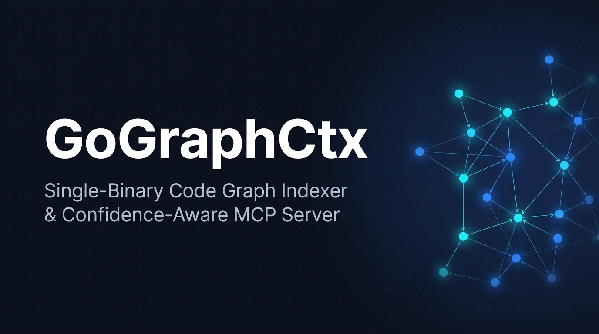

<div align="center">

<p>
  <a href="README.md">English</a> ·
  <a href="README.zh-CN.md">简体中文</a> ·
  <a href="README.ja.md">日本語</a> ·
  <a href="README.ko.md">한국어</a> ·
  <a href="README.es.md">Español</a> ·
  <a href="README.pt-BR.md">Português (BR)</a> ·
  <strong>Deutsch</strong> ·
  <a href="README.fr.md">Français</a>
</p>



<h1>GoGraphCtx</h1>

<p>
  <strong>Abhängigkeitsfreier Single-Binary Code-Graph-Indexer &amp; Confidence-Aware MCP-Server für KI-Coding-Agents</strong>
</p>

<p>
  <a href="https://github.com/roshankumar0036singh/gographctx/actions/workflows/unit-tests.yml"></a>
  <a href="https://github.com/roshankumar0036singh/gographctx/actions/workflows/lint-security.yml"></a>
  
  <a href="LICENSE"></a>
  
  
  <a href="CONTRIBUTING.md"></a>
</p>

<p>
  <em>Liefert Claude Code, Cursor, Windsurf, VS Code Copilot und Cline präzise Call-Graphen, Impact-Analysen und Repository-Strukturen in <strong>533ms</strong>—ganz ohne Neo4j, Docker oder Python.</em>
</p>

</div>

---

## Kurze Terminal-Demo

<p align="center">
  
</p>

<details>
<summary><strong>Architektur- &amp; Vergleichsgrafik anzeigen</strong></summary>
<p align="center">
  
</p>
</details>

---

## Warum GoGraphCtx?

1. **Schluss mit `grep`-Token-Verschwendung:** Statt tausende Zeilen durch wiederholte Textsuche zu lesen, liefert GoGraphCtx strukturierte Antworten innerhalb strikter Token-Budgets (`4000` Standard).
2. **8-stufiges Konfidenzmodell:** Unterscheidet konsequent zwischen verifizierten `CALLS`-Kanten und unsicheren `LIKELY_CALLS` / `CallSite`-Kandidaten.
3. **15,8 MB Statisches Binary ohne externe Datenbank:** Eingebaute Pure-Go `gotreesitter`-Grammatiken (`CGO_ENABLED=0`) für **Go, Python, TypeScript/TSX, JavaScript/JSX, Rust und Java**.
4. **Inkrementelles Live-Watching (`~22,8ms`):** `fsnotify` aktualisiert bei Änderungen nur betroffene Dateien und deren Abhängigkeiten.

---

## Schnellstart

```bash
go install github.com/roshankumar0036singh/gographctx/cmd/gographctx@latest

gographctx index ./your-repo
gographctx stats ./your-repo
gographctx query get_impact pkg::Service::Handle ./your-repo
```

```bash
# Claude Code MCP einrichten
claude mcp add gographctx -- gographctx watch /absolute/path/to/your/repo
```

---

## Gemessene Benchmarks & Tool-Vergleich

Gemessen mit [`cmd/ggctx-bench`](cmd/ggctx-bench/main.go) (`go1.25.1`, `windows/amd64`, 16 vCPUs):

| Metrik | Gemessen | SLA-Ziel |
|---|---|---|
| **Python-Repo im Flask-Maßstab** (83 `.py`) | **533.39 ms** / **51.02 MB RSS** | `< 1s` / `< 80 MB` |
| **Go-Monorepo** (1.000 `.go`) | **1,401.70 ms** / **116.92 MB RSS** | `< 3s` / `< 150 MB` |
| **Anteil sicherer Call-Kanten (Flask)** | **100.0%** | `>= 85%` |
| **Inkrementelles Update (p50)** | **22.78 ms** (Body) / **22.77 ms** (Export) | `< 50ms` / `< 100ms` |
| **MCP-Latenz (p95) / Binary-Größe** | **3.80 ms** / **15.79 MB** | `< 10ms` / `< 30 MB` |

Den vollständigen Vergleich gegen **CGC**, **SCIP**, **Universal Ctags**, **ast-grep**, **Serena** und **ripgrep** finden Sie unter [docs/benchmarks.md](docs/benchmarks.md).

## Dokumentation

- [MCP-Tools-Referenz](docs/mcp-tools.md) · [CLI & Konfiguration](docs/cli-and-config.md) · [Architektur](docs/architecture.md) · [Sprachunterstützung](docs/languages.md) · [Benchmarks](docs/benchmarks.md) · [Mitwirken](CONTRIBUTING.md)

Wenn Ihnen GoGraphCtx weiterhilft, freuen wir uns über einen **Star**!
