<div align="center">

<p>
  <a href="README.md">English</a> ·
  <a href="README.zh-CN.md">简体中文</a> ·
  <a href="README.ja.md">日本語</a> ·
  <strong>한국어</strong> ·
  <a href="README.es.md">Español</a> ·
  <a href="README.pt-BR.md">Português (BR)</a> ·
  <a href="README.de.md">Deutsch</a> ·
  <a href="README.fr.md">Français</a>
</p>


<h1>GoGraphCtx</h1>

<p>
  <strong>AI 코딩 에이전트를 위한 단일 바이너리, 무의존성 코드 그래프 인덱서 &amp; 신뢰도 기반 MCP 서버</strong>
</p>

<p>
  <a href="https://github.com/roshankumar0036singh/gographctx/actions/workflows/unit-tests.yml"></a>
  <a href="https://github.com/roshankumar0036singh/gographctx/actions/workflows/lint-security.yml"></a>
  
  <a href="LICENSE"></a>
  
  
  <a href="CONTRIBUTING.md"></a>
</p>

<p>
  <em>Claude Code, Cursor, Windsurf, VS Code Copilot, Cline을 위해 정확한 호출 그래프, 영향도 분석(Blast Radius), 코드 구조를 <strong>533ms</strong> 만에 구축합니다. <strong>Neo4j, Docker, Python 의존성이 전혀 필요 없습니다.</strong></em>
</p>

</div>

---

## 터미널 데모

<p align="center">
  
</p>

<details>
<summary><strong>아키텍처 및 비교 인포그래픽 보기</strong></summary>
<p align="center">
  
</p>
</details>

---

## 왜 GoGraphCtx를 사용해야 하나요?

1. **`grep` 탐색으로 인한 토큰 낭비 제거**: 주석이나 임포트, 동명이인 심볼을 반복 검색하는 대신 기본 `4000` 토큰 예산 안에 맞춘 구조화된 호출 관계를 즉시 반환합니다.
2. **추측을 사실로 포장하지 않는 정직한 신뢰도**: 8단계 신뢰도 계층으로 확실한 `CALLS` 간선과 불확실한 `LIKELY_CALLS` / `CallSite` 후보를 엄격히 구분합니다.
3. **15.8 MB 단일 정적 바이너리**: 내장 `gotreesitter`(`CGO_ENABLED=0`)로 **Go, Python, TypeScript/TSX, JavaScript/JSX, Rust, Java**를 지원하며 외부 그래프 DB가 필요 없습니다.
4. **초고속 증분 감시 (`~22.8ms`)**: `fsnotify` 기반 역의존성 추적으로 파일 수정 시 영향받는 파일만 실시간으로 재해석합니다.

---

## 빠른 시작

```bash
go install github.com/roshankumar0036singh/gographctx/cmd/gographctx@latest

gographctx index ./your-repo
gographctx stats ./your-repo
gographctx query get_impact pkg::Service::Handle ./your-repo
```

```bash
# Claude Code MCP 연동
claude mcp add gographctx -- gographctx watch /absolute/path/to/your/repo
```

---

## 실측 벤치마크 & 타 도구 비교

[`cmd/ggctx-bench`](cmd/ggctx-bench/main.go) (`go1.25.1`, `windows/amd64`, 16 vCPU) 실측 결과:

| 벤치마크 항목 | 실측 결과 | 목표 SLA |
|---|---|---|
| **Flask 규모 Python** (83개 `.py` 파일) | **533.39 ms** / **51.02 MB RSS** | `< 1s` / `< 80 MB` |
| **Go 모노레포** (1,000개 `.go` 파일) | **1,401.70 ms** / **116.92 MB RSS** | `< 3s` / `< 150 MB` |
| **Flask 고신뢰 티어 비율** | **100.0%** | `>= 85%` |
| **증분 업데이트 (p50)** | **22.78 ms** (본문) / **22.77 ms** (시그니처) | `< 50ms` / `< 100ms` |
| **MCP 쿼리 지연 (p95) / 바이너리 크기** | **3.80 ms** / **15.79 MB** | `< 10ms` / `< 30 MB` |

CGC, SCIP, Universal Ctags, ast-grep, Serena, ripgrep과의 상세 비교(**Flask 정밀도 98.4% vs CGC 69.2%**, `unresolved_hints` 미해결 호출 공개 및 **492 ms vs 92.7 s** 인덱싱 속도 포함)는 [docs/benchmarks.md](docs/benchmarks.md)를 참고하세요.

## 문서 안내

- [MCP 도구 레퍼런스](docs/mcp-tools.md) · [CLI 및 설정 가이드](docs/cli-and-config.md) · [아키텍처](docs/architecture.md) · [지원 언어](docs/languages.md) · [벤치마크](docs/benchmarks.md) · [기여 가이드](CONTRIBUTING.md)

도움이 되셨다면 저장소에 **Star**를 눌러 주세요!
