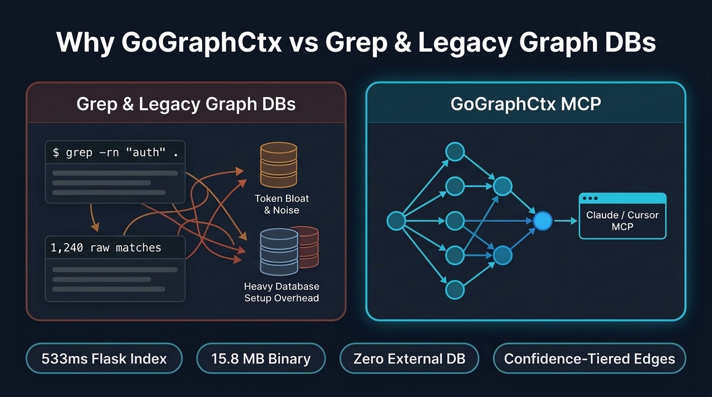

<div align="center">

<p>
  <strong>English</strong> ·
  <a href="README.zh-CN.md">简体中文</a> ·
  <a href="README.ja.md">日本語</a> ·
  <a href="README.ko.md">한국어</a> ·
  <a href="README.es.md">Español</a> ·
  <a href="README.pt-BR.md">Português (BR)</a> ·
  <a href="README.de.md">Deutsch</a> ·
  <a href="README.fr.md">Français</a>
</p>


<h1>GoGraphCtx</h1>

<p>
  <strong>Single-Binary, Zero-Dependency Code Graph Indexer &amp; Confidence-Aware MCP Server for AI Coding Agents</strong>
</p>

<p>
  <a href="https://github.com/roshankumar0036singh/gographctx/actions/workflows/unit-tests.yml"></a>
  <a href="https://github.com/roshankumar0036singh/gographctx/actions/workflows/lint-security.yml"></a>
  
  <a href="LICENSE"></a>
  
  
  
  <a href="CONTRIBUTING.md"></a>
</p>

<p>
  <em>Give Claude Code, Cursor, Windsurf, VS Code Copilot, and Cline an accurate, token-budgeted call graph, blast-radius analysis, and repository structure—in <strong>533ms</strong> with <strong>zero Neo4j, Docker, or Python dependencies</strong>.</em>
</p>

</div>

---

## Short Interactive Demo

<p align="center">
  
</p>

<details>
<summary><strong>View Architecture &amp; Comparison Visual</strong></summary>
<p align="center">
  
</p>
</details>

---

## Why Use GoGraphCtx?

AI coding agents struggle on real codebases for three reasons:

1. **The "Context Tax" of `grep` and `glob`:** Agents waste thousands of tokens and dozens of round-trips scanning comments, imports, and homonyms (`Service.run` vs `Job.run`) instead of traversing actual cross-file call chains.
2. **Silent Guesses in Heuristic Graph Tools:** Legacy code-graph tools often emit fallback guesses (substring path matches or alphabetical-first matches) as verified call edges, causing agents to miss callers or refactor the wrong function.
3. **Heavy Infrastructure:** Python/Cypher graph servers require Neo4j/FalkorDB/Docker containers, ~90 pip dependencies, or brittle per-language LSP setups, taking seconds per query and hundreds of megabytes of RAM.

**GoGraphCtx solves all three in one 15.8 MB static binary:**
- **Pure-Go AST & Resolution Engine:** Compiled-in `gotreesitter` parsers (`CGO_ENABLED=0`) for **Go, Python, TypeScript/TSX, JavaScript/JSX, Rust, and Java**.
- **8-Tier Confidence Model:** Every edge carries explicit confidence (`certain` vs `LIKELY_CALLS` vs `CallSite` evidence). Speculative guesses are never misrepresented as verified facts.
- **Zero External Graph Database:** Builds an indexed in-memory graph and persists an atomic, zstd-compressed binary snapshot + CRC32C Write-Ahead Log (`.ggctx/index.ggctx`).
- **7 Token-Budgeted MCP Tools:** Designed around strict LLM context budgets (`default: 4000` tokens) with binary-search shrinking, repo-relative paths, and confidence summaries—instead of 30–50 noisy overlapping tools.
- **Real-Time Incremental Watcher (`~22.8ms`):** `fsnotify` re-indexes changed files and affected reverse-dependents in milliseconds alongside live MCP serving.

---

## 30-Second Quickstart

### 1. Install
```bash
go install github.com/roshankumar0036singh/gographctx/cmd/gographctx@latest
```
*(Or build locally from source: `git clone https://github.com/roshankumar0036singh/gographctx.git && cd gographctx && make build`.)*

### 2. Index & Query Any Repository
```bash
# Index a repository in ~0.5s (creates .ggctx/index.ggctx)
gographctx index ./your-repo

# Check index statistics & resolution coverage
gographctx stats ./your-repo

# Run an impact analysis query directly from CLI
gographctx query get_impact pkg::Service::Handle ./your-repo
```

### 3. Connect Your AI Coding Agent (MCP)

<details open>
<summary><strong>Claude Code</strong></summary>

```bash
claude mcp add gographctx -- gographctx watch /absolute/path/to/your/repo
```
</details>

<details>
<summary><strong>Cursor / Windsurf / Claude Desktop / Cline</strong></summary>

Add to `~/.cursor/mcp.json` or `claude_desktop_config.json`:
```json
{
  "mcpServers": {
    "gographctx": {
      "command": "gographctx",
      "args": ["watch", "/absolute/path/to/your/repo"]
    }
  }
}
```
</details>

<details>
<summary><strong>VS Code Copilot MCP (<code>.vscode/mcp.json</code>)</strong></summary>

```json
{
  "servers": {
    "gographctx": {
      "type": "stdio",
      "command": "gographctx",
      "args": ["serve", "${workspaceFolder}"]
    }
  }
}
```
</details>

---

## Measured Benchmarks & Multi-Tool Comparison

All GoGraphCtx numbers below were measured directly via [`cmd/ggctx-bench`](cmd/ggctx-bench/main.go) (`go1.25.1`, `windows/amd64`, 16 vCPUs):

| Benchmark Metric | Measured Result | Target SLA |
|---|---|---|
| **Flask-scale Python repo** (83 `.py` files, 705 nodes, 2,208 edges) | **533.39 ms** / **51.02 MB RSS** | `< 1s` / `< 80 MB` |
| **Go monorepo** (1,000 `.go` files, 6,002 nodes, 8,000 edges) | **1,401.70 ms** / **116.92 MB RSS** | `< 3s` / `< 150 MB` |
| **Flask strong-tier call edge ratio** | **100.0%** (`TierStructural..TierSamePackage`) | `>= 85%` |
| **Incremental file update** (body edit / export change, p50) | **22.78 ms** / **22.77 ms** | `< 50ms` / `< 100ms` |
| **MCP tool query latency** (warm stdio, p95) | **3.80 ms** | `< 10 ms` |
| **CLI cold startup** (`gographctx version`, p50) | **22.80 ms** | `< 50 ms` |
| **Stripped static binary** (`CGO_ENABLED=0`) | **15.79 MB** | `< 30 MB` |

### How GoGraphCtx Compares Against Other Code Intelligence Tools

| Tool | Category | Runtime / Setup | Call Graph | Impact BFS | Confidence Tiers | Key Trade-off vs GoGraphCtx |
|---|---|---|---|---|---|---|
| **GoGraphCtx** | Code-Graph MCP | **15.8 MB static Go binary**, zero external DB | Yes | Yes (`get_impact`) | **Yes** (8 tiers + `LIKELY_CALLS` + `unresolved_hints`) | **98.4% Flask precision**, sub-second index, zero DB setup (trades aggressive speculative guesses for high-precision edges + explicit unresolved disclosure) |
| **CodeGraphContext (CGC)** | Code-Graph MCP | Python + ~90 pip deps + Neo4j / FalkorDB / Kuzu | Yes | Yes | Partial (emits Tier 7–8 guesses as facts; ~61% of edges) | **69.2% Flask precision**, higher heuristic recall (~70% vs Jedi), requires Cypher DB & Python env |
| **SCIP** (`scip-python`, `scip-go`) | Compiler Oracle | Node/Python/Go toolchain + full dependency install | Yes | External script | Exact compiler oracle | Requires buildable env & project deps installed |
| **Universal Ctags** | Tag Indexer | Native CLI binary | No | No | No | No cross-file call graph or receiver type resolution |
| **ast-grep (`sg`)** | AST Search CLI | Rust binary | No | No | Exact syntax match | Great ad-hoc syntax search, no persistent call/impact graph |
| **Serena** | LSP MCP Server | Python + live language servers (`pyright`, `gopls`) | Yes | Limited | Type-checker-backed | Heavier LSP warmup & 50+ tool context footprint |
| **ripgrep (`rg`)** | Lexical Search | Rust binary | No | No | Text only | Fast regex, high noise on homonyms/imports/comments |

See [docs/benchmarks.md](docs/benchmarks.md) for reproduction commands (`ggctx-bench`), SCIP ground-truth evaluation details, and CI release regression workflows.

---

## 7 Focused MCP Tools

| Tool | Purpose | Key Parameters |
|---|---|---|
| `find_symbol` | Pattern/kind/file/language symbol lookup | `name`, `kind`, `file`, `language`, `exported_only`, `limit` |
| `get_callers` | Direct callers with confidence tier & call sites | `symbol`, `file`, `include_likely`, `limit` |
| `get_callees` | Direct callees with confidence tier & call sites | `symbol`, `file`, `include_likely`, `limit` |
| `get_impact` | Transitive reverse-dependency blast radius | `symbol`, `file`, `max_depth`, `limit` |
| `file_outline` | Structured imports, classes, functions, fields, vars | `file`, `include_private` |
| `search_code` | Multi-filter query with cyclomatic complexity | `name_pattern`, `qname_pattern`, `kinds`, `min_complexity`, `max_complexity` |
| `repo_overview` | Repo metrics, language mix & coverage summary | `include_top_complex`, `limit` |

Full JSON schemas and envelope examples are documented in [docs/mcp-tools.md](docs/mcp-tools.md).

---

## Comprehensive Documentation

- **[MCP Tools Reference](docs/mcp-tools.md)** — Complete schemas, confidence summaries, and token-budget truncation behavior
- **[CLI, Configuration & IDE Setup](docs/cli-and-config.md)** — `index`, `serve`, `watch`, `query`, `stats`, `.ggctxrc`, `.ggctxignore`, `GGCTX_*` env vars, and editor configs
- **[Architecture & Storage](docs/architecture.md)** — In-memory `Graph`/`ReadView`, compact `.ggctx` binary snapshots, CRC32C WAL, 8-tier resolver, and `fsnotify` watcher
- **[Language Support Matrix](docs/languages.md)** — Go, Python, TypeScript/TSX, JavaScript/JSX, Rust, and Java AST + resolution capabilities
- **[Benchmarks & SCIP Validation](docs/benchmarks.md)** — Reproducible benchmark methodology and multi-tool comparison suite
- **[Contributing Guide](CONTRIBUTING.md)** · **[Security Policy](SECURITY.md)** · **[Code of Conduct](CODE_OF_CONDUCT.md)** · **[MIT License](LICENSE)**

---

## Contributing & Community

Contributions of all sizes are welcome! Check [CONTRIBUTING.md](CONTRIBUTING.md) to set up your local environment, add new language resolvers, or run `make bench-suite`.

If GoGraphCtx saves tokens and time for your AI coding workflow, please consider giving the repository a **Star**!
